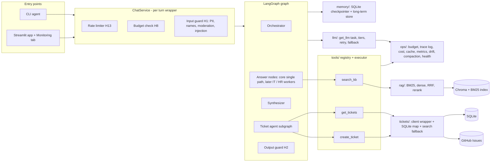
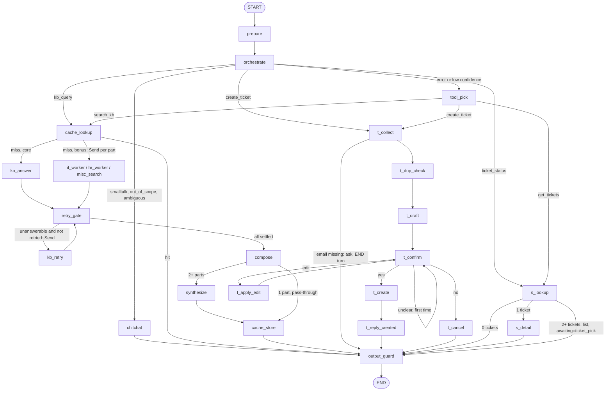

# PLAN.md: SmartDesk AI architecture and build plan

Source of truth: `SPEC.md` (draft v3, approved). This plan designs against it. Section 9 lists the spec issues found against draft v2; all are resolved in v3 and kept as a record of why. The core milestone (10-18) is SPEC sections 3A to 3G.
Today is 2026-10-13. Core target 10-18, deadline 10-23. Library-specific API claims below (LangGraph, Langfuse, LangSmith, Ragas, OpenAI params) are from memory and must be verified in the Phase 0 spike, not assumed.

---

## 1. Design principles

1. **Core first, fan-out later.** The graph is built around `parts: list[SubQuestion]` from day one. In core the orchestrator emits exactly one part (prompt `orchestrator_v1`); multi-part and `Send` fan-out arrive with `orchestrator_v2` (section 3I) without reshaping state or nodes. The core KB node is the same function (`answer_part`) the IT/HR workers later call.
2. **Everything external sits behind an interface with a mock.** LLM, embeddings, reranker, GitHub, Redis, Presidio, tracing. `LLM_MODE=mock`, `TICKETS_MODE=mock` (config/env) select fakes. `pytest` never touches the network (CLAUDE.md).
3. **Guards live in code, not prompts.** The executor enforces confirmation, schema, email validity, retries and dedupe (FR-G3 to G6). The graph enforces the one interrupt (FR-G12).
4. **Privacy at the sinks.** Redaction runs on input (before graph, checkpointer, LLM) and again in the trace/log layer (FR-G11, H1, H9).
5. **Degrade, never crash** (FR-F7): each optional component registers itself in `ops/health.py`; the Monitoring tab reads that registry.

---

## 2. Component architecture



**Layering (import direction, to avoid cycles):** `config` -> `guardrails/pii,names` (leaf, no LLM) -> `ops` -> `llm` -> `guardrails/input,output` -> `rag`, `tickets` -> `tools` -> `agent` -> `ui`. `ops/tracelog` may import only `guardrails.pii` and `guardrails.names` (keep `guardrails/__init__.py` empty).

**SQLite files** (under gitignored `data/`): `checkpoints.db` (LangGraph saver, owns its tables) and `app.db` (email-ticket map, long-term memory, cost/budget ledger, rate-limit counters, tool-call log, stale flags, drift runs). WAL mode plus a write lock, because fan-out nodes log concurrently.

---

## 3. Module interfaces

Signatures only. Pydantic models for every boundary (CLAUDE.md).

### 3.1 `config/` (`env.py`, `settings.py`), `config.yaml`
```python
class Settings(BaseModel): ...      # models, tier map, prices, windows, thresholds, prompt versions, modes
def load_settings(path: Path = ...) -> Settings   # config.yaml + env overrides; cached
```
`config.yaml` keys (FR-H16): `models.{main,light}`, `reasoning_effort`, `task_tiers{}`, `context_windows`, `prices`, `budget.{cutoff1,cutoff2,timezone}`, `rate_limits.{questions,creates,lookups,window_s,bypass}`, `compaction.trigger_pct`, `retrieval.{strategy=hybrid_rerank,k_each=20,rrf_k=60,top_n=5}`, `thresholds.{escalation (top dense cosine),routing_confidence,semantic_cache_cutoff,injection_heuristic}`, `routing.confidence_threshold`, `cache.{semantic_cutoff,enabled}`, `input.max_chars`, `prompts{name: version}`, `modes.{llm,tickets}`, `github.{api_base_url,api_version,timeout_seconds,per_page}` (added T3.10).

### 3.2 `llm/`
```python
class Task(StrEnum): ORCHESTRATOR; WORKER_ANSWER; SYNTHESIZER; GROUNDING_JUDGE; TOOL_SELECT; TICKET_DRAFT; INJECTION_CLASSIFIER; COMPACTION   # + CONFIRM_PARSE, CHITCHAT (flag F-11)
class Tier(StrEnum): MAIN; LIGHT
def get_llm(task: Task, *, agent: str, ctx: CallContext) -> BaseChatModel
def get_embeddings() -> Embeddings
```
`get_llm` returns a wrapper that, **at call time**: resolves tier (task map -> budget cutoff 1 forces LIGHT -> outage fallback to the other tier), retries with backoff, calls the fallback tier on exhaustion, raises `LLMUnavailable` if both fail, and writes one `LlmRecord` to `ops.trace_log` (agent, prompt name+version, prompt/completion redacted, model, tier, tokens in/out, latency, session, masked user, cost). Files: `sd/llm/factory.py` (`get_llm`), `tiers.py` (`Task`, `Tier`, map), `retry.py`, `fallback.py`, `fake.py` (scripted `FakeChatModel` that also records the exact messages it received, used to prove worker context isolation).

### 3.3 `rag/`
```python
class Chunk(BaseModel): chunk_id; entry_id; domain; title; header; text; source_file; piece; pieces   # .embed_text = header + text
class ScoredChunk(BaseModel): chunk: Chunk; score: float; stage: str
class KBIndex: chunks; bm25; collection; embeddings                # both indexes plus the query embedder
def parse_entries(text, source) -> list[Entry]                     # kb_schema.py; validate_entries() checks unique ids
def chunk_entry(e: Entry, cfg: Chunking, count=count_tokens) -> list[Chunk]   # fixed512 variant added for FR-A17 (T2.11)
def ingest(kb_dir, index_dir, embeddings, cfg, on_kb_changed=None) -> IngestReport   # idempotent; 5 policy files only; prunes orphans; embeds only new/changed files; callback = answer-cache clear (FR-H6)
def check_staleness(kb_dir, index_dir, cfg, embedder_id) -> StaleReport    # read-only: stale files and chunk ids from per-file hashes
def open_index(index_dir, embeddings) -> KBIndex                   # raises IndexNotBuilt
def bm25_search(index, query, k, domain=None) -> list[ScoredChunk]
def dense_search(index, query, k, domain=None) -> list[ScoredChunk]
def rrf(rankings: list[list[ScoredChunk]], *, k) -> list[ScoredChunk]      # k comes from config.retrieval.rrf_k
class Reranker(Protocol): def rerank(query, candidates) -> list[ScoredChunk]   # all candidates, best first, sigmoid scores 0..1
def collapse_to_entries(ranked, top_n) -> list[ScoredChunk]       # best piece per entry
class CrossEncoderReranker; class NoopReranker                     # Noop = RRF order (FR-F7)
def retrieve(index, query, *, domain=None, cfg, reranker: Reranker | None, health=None) -> RetrievalResult   # {entries (full parent text), ordered_by, top_cosine, answerable, signals, threshold}; follows config retrieval.strategy (hybrid_rerank | dense | hybrid | dense_rerank)
def assess(n_chunks, top_cosine, thresholds) -> Answerability     # signals 1-2 on the top dense cosine and the one thresholds.escalation (SPEC v3.1)
def load_reranker(cfg, health=None) -> Reranker | None            # None + degraded mode on any load failure (FR-F7)
```
Every stage takes the opened `KBIndex` as its first argument instead of reading module state, so tests and `evals/` can point a stage at any index and call any subset (FR-A6, A7). `weighted_fusion` is not built: FR-A7 compares BM25, dense, RRF and RRF + rerank only, so it returns only if an ablation needs it.
Files: `sd/rag/kb_schema.py` (`Entry`, validator), `models.py` (`Chunk`, `ScoredChunk`), `chunking.py` (`chunk_entry`), `embeddings.py` (`HashingEmbeddings` mock, `get_embeddings`), `index.py` (layout, `KBIndex`, `open_index`, `bm25_tokens`), `ingest.py`, `staleness.py` (file hashes, stale flags), `retrievers.py` (`bm25_search`, `dense_search`), `fusion.py` (`rrf`), `rerank.py` (`Reranker`, `CrossEncoderReranker`, `NoopReranker`, entry collapse), `answerable.py` (signals 1-2), `pipeline.py` (`retrieve`).

### 3.4 `tickets/`
```python
class Category(StrEnum): IT; HR; MISC
class Priority(StrEnum): LOW; MEDIUM; HIGH; CRITICAL
class TicketStatus(StrEnum): OPEN; IN_PROGRESS; RESOLVED; CLOSED
class TicketClient(Protocol):
    def create(self, d: TicketCreate) -> Ticket
    def get(self, number: int) -> Ticket
    def latest_update(self, number: int) -> TeamUpdate | None            # newest comment by OWNER/MEMBER/COLLABORATOR; text is untrusted, use .quoted()
    def find_by_request_id(self, request_id: str) -> Ticket | None   # uses list-issues, not search (flag F-03)
    def search_by_email(self, email: str) -> list[Ticket]
class GitHubRestClient; class MockTicketClient                       # GitHubMcpClient only if time allows
class TicketStore:  begin/complete/get (request log, FR-G6); link_email(email, number); numbers_for(email)   # built T3.7, T3.13
def find_tickets(email, client, store) -> list[Ticket]               # map + search merged by issue number, new numbers backfilled (FR-C11)
def derive_status(state: str, labels) -> TicketStatus                # FR-C6
```
**As built (T3.10 to T3.16).** `TicketClient` also has `ensure_labels(labels)` (idempotent, FR-B11); `create_ticket_client(settings, env)` picks `MockTicketClient` or `GitHubRestClient` from `modes.tickets` (config only, no `TICKETS_MODE` env override; live mode without `GITHUB_TOKEN`/`TICKETS_REPO` raises `TicketConfigError`). `Ticket` is `{number, url, title, body, state, labels}` copied from the GitHub response, with `.status` and `.receipt()`; a response missing a field raises `TicketError`, never a filled-in ticket (FR-B13). Transient failures (network, timeout, 429, 5xx, rate-limit 403) raise `TransientTicketError`, a `ConnectionError` subclass, so the executor retries them without `tickets/` importing `tools/`. `MockTicketClient` can `fail_before_create`, `lose_responses`, `fail_searches`, or go `unreachable` (T3.18), and has `add_issue`/`add_comment` for hand-made data. `update_issue` and `add_comment` exist on both clients for the seed script (T3.17). `ToolResult.reply` holds the polite retry-later text when a call is unavailable (FR-F1). Scripts that can create things in the public repo (`seed_tickets.py`, `setup_labels.py`) need `--confirm-live` in live mode; mock runs of the seed script use an in-memory map. The executor writes the email map row after a successful create; `tools/ticket_tools.py` registers `create_ticket` with `find_by_request_id` as its recovery check. `get_tickets` is not registered yet: it composes `find_tickets`, `derive_status` and `latest_update` in the status flow (Phase 4).
Files: `sd/tickets/github_client.py` (`TicketClient`, `GitHubRestClient`, `MockTicketClient`, body/label building), `schemas.py` (enums, models), `sqlite_map.py` (`TicketMap`), `search_fallback.py` (`find_tickets`), `status.py` (`derive_status`).
Ticket body is built in one place: description, then `Employee: <email>`, then `Request-ID: <uuid>` (FR-B11, G6).

### 3.5 `tools/`
```python
class ToolSpec(BaseModel): name; description; args_model: type[BaseModel]; fn: Callable; allowed_agents: set[str]
REGISTRY: dict[str, ToolSpec]       # search_kb, create_ticket, get_tickets
class ToolResult(BaseModel): ok; data; error: ToolError | None; attempts: int; latency_ms
def execute(call: ToolCall, *, caller: str, ctx: ExecContext) -> ToolResult
```
Files: `sd/tools/definitions.py` (`ToolSpec`, arg models), `registry.py` (`REGISTRY`), `executor.py` (`execute`), `search_kb.py`. `execute` order: caller allowed -> validate args (no retry) -> tool guards (`create_ticket` needs `ctx.confirmation` token set only by the confirm node; email valid) -> up to 3 attempts, transient errors only, short backoff -> before any *retry* of `create_ticket`, `find_by_request_id` -> unavailable error -> metrics row (tool, agent, outcome, attempts, per-attempt and total latency, masked args). `search_kb` returns `{chunks, scores, answerable}` (FR-G7).

### 3.6 `guardrails/`
```python
class PiiRedactor: redact(text, *, keep_emails=True) -> Redacted      # Presidio, regex fallback (F7)
def reduce_names(text) -> str                                         # "John Doe" -> "John D."
def mask_email(email) -> str                                          # salted hash + domain-free; used by logs/traces
class InputGuard: check(text, ctx) -> GuardResult                     # {allowed, text, reason, flags}
class OutputGuard: grounding(answer, chunks) -> GroundingVerdict; finalize(reply) -> str   # moderation + PII scan
```
Files: `sd/guardrails/pii.py` (`PiiRedactor`, `mask_email`), `names.py` (`reduce_names`), `injection.py`, `input_guard.py` (`InputGuard`), `output_guard.py` (`OutputGuard`; the grounding judge itself runs inside `agent/answer.py`, FR-H2).

Built in T5.1 to T5.5: `names.py` exposes `NameReducer.reduce`; `moderation.py` (Moderator interface, `OpenAIModerator`, offline `KeywordModerator`) and `decision.py` (`GuardDecision`) were added; `injection.py` also holds `screen_team_update`, wired into the `get_tickets` tool through `register_ticket_tools(screen_update=...)`. `build_service` builds the guard by default (`build_input_guard`). Presidio is loaded once per process, never auto-downloads its spaCy model, and Aadhaar and PAN are regex-only.

### 3.7 `ops/`
`budget.py` (`BudgetGuard.level() -> 0|1|2`, `record(cost)`; persisted per day in `app.db`), `cost.py` (price table, per-request/task/agent/tier/step cost), `rate_limit.py` (`RateLimiter.check(kind, key) -> Allowed | Denied(wait_minutes)`), `trace_log.py` (local sink + optional Langfuse/LangSmith sinks, masked), `tracing.py` (optional Langfuse/LangSmith sinks with masking), `metrics.py`, `hitl_counters.py`, `drift.py`, `compaction.py` (`maybe_compact(state) -> StatePatch`), `cache.py` (`AnswerCache` Protocol; `RedisCache`, `InMemoryCache`; `get/put/clear`), `health.py` (`register_degraded(component, reason)`).

Built in T5.9 to T5.16: `runtime.py` holds a per-request scope (`ChatService` opens it; `FallbackChat`, the tool executor and `CostedEmbeddings` find it with `current_scope()`), so cost tracking (`cost.py`), the daily budget (`budget.py`, level read on every LLM call; level 2 stops the chat), rate limits (`rate_limit.py`, checked in `ChatService` and the executor) and the trace log need no plumbing through the makers. `compaction.py` runs as a graph node before `entry`. `trace_log.py` writes one masked JSON line per request, reply, agent step, tool attempt, tool call and LLM call, and forwards each masked record to the optional `tracing.py` sinks (Langfuse, LangSmith), which also keep the SDK masking hooks on. Runtime files in `data/`: `trace.jsonl`, `tool_metrics.jsonl`, `cost.jsonl`, `ops.db` (daily spend and rate-limit counters).

### 3.8 `memory/`
`checkpointer.py` (`make_checkpointer(path)`), `long_term.py` (`LongTermStore.record_ticket(email, number, category)`, `.recall(email) -> list[int]`, `.last_category(email)`).

### 3.9 `agent/`
```python
class Deps(BaseModel): settings; llm_factory; tools; ticket_client; stores; ...   # DI container; mock vs live
def build_graph(deps: Deps) -> CompiledStateGraph
class ChatService:
    def handle(self, session_id: str, text: str) -> ChatReply    # the per-turn pipeline, section 5
def load_prompt(name: str) -> Prompt                              # {text, version}; version from config
```
Files (`sd/agent/`): `state.py`, `intents.py`, `router.py` (routing, scope boundary), `orchestrator.py`, `answer.py` (`answer_part`: answer, citations, grounding judge), `workers.py` (IT/HR worker nodes calling `answer_part`), `synthesizer.py`, `ticket_agent.py` (ticket flow), `confirm.py` (approval gate parse), `status_flow.py`, `chitchat.py`, `graph.py`, `chat_service.py`, `prompt_loader.py`, `__main__.py`, `prompts/*_vN.md`.

### 3.10 Layout additions needing approval (SPEC section 6 is silent)
`sd/config/` package (`env.py`, `settings.py`), `agent/__main__.py` (CLAUDE.md `python -m smartdesk_ai.agent`), `agent/chat_service.py`, `agent/prompt_loader.py`, `ops/health.py`, `evals/run.py` (`python -m evals.run`), `scripts/setup_labels.py` (FR-B11 "labels created once"), `spikes/` (Phase 0 throwaway scripts), `data/` (gitignored). `sd/` stands for `smartdesk_ai/`.

---

## 4. LangGraph design

### 4.1 State (`AgentState`, Pydantic model, checkpointed per `thread_id = session_id`)
| Field | Type | Notes |
|---|---|---|
| `messages` | `Annotated[list[AnyMessage], add_messages]` | already redacted, names reduced |
| `summary` | `str` | running compaction summary (FR-H5) |
| `email` | `str \| None` | validated; set by regex extraction, never guessed (FR-B13) |
| `last_topic` | `str \| None` | FR-D2 |
| `awaiting` | `None \| offer_reply \| email \| ticket_pick` | dialog state for non-interrupt turn ends (flag F-10) |
| `intent` | `IntentResult{intent, confidence, route_source}` | FR-D1, D8 |
| `parts` | `list[SubQuestion{part_id, text, domain}]` | core: length 1 |
| `part_results` | `Annotated[dict[str, PartResult], merge_by_key]` | keyed merge so the whole-KB retry overwrites, never duplicates |
| `PartResult` | `{answer, citations, chunks+scores, answerable, signals{no_chunks, low_score, llm_insufficient, ungrounded}, retried}` | |
| `pending_offer` | `{unanswered_text} \| None` | ticket offered, not yet accepted |
| `ticket` | `TicketDraft \| None` | `{request_id, email, title, description, category, priority, phase, confirmed, issue_number, url}` |
| `status_candidates` | `list[TicketRef]` | FR-C3 pick list |
| `reply` | `str` | |
| `cache_hit`, `steps`, `errors` | misc | `steps` feeds steps-to-completion (FR-H11) |

### 4.2 Nodes
| Node | Does | LLM tier |
|---|---|---|
| `prepare` | extract/validate email (regex), compaction check (H5), long-term recall when an email first appears (H10) | Light (compaction only) |
| `orchestrate` | one structured call: intent + confidence + parts (rewritten standalone, domain-tagged); sees `awaiting` | Main |
| `tool_pick` | fallback route when classifier errors/invalid/low-confidence (FR-D8); binds the three tool schemas | Light |
| `chitchat` | smalltalk, out_of_scope deflection, or one clarifying question; no tool | Light (flag F-11) |
| `cache_lookup` / `cache_store` | KB answers only, keyed on the rewritten sub-question (flag F-06) | embedding only |
| `kb_answer` (core) = `answer_part(part, domain=None)` | `search_kb` via executor -> answer from chunks only, citations, `llm_insufficient` flag -> grounding check | Main (+ judge Main) |
| `it_worker`, `hr_worker`, `misc_search` (bonus) | same `answer_part` with domain filter / domain prompt, dispatched by `Send` | Main |
| `retry_gate` | for each unanswerable part not yet retried: `Send` to `kb_retry` (no domain filter); else continue | none |
| `kb_retry` | `answer_part(part, domain=None)` with a neutral prompt | Main |
| `compose` | 1 part -> pass-through (no LLM); 2+ parts -> `synthesize` (FR-I5, I7); appends ticket offer for unanswered parts and sets `pending_offer`, `awaiting=offer_reply` | Main (multi only) |
| `t_collect` | ensure valid email (else ask, `awaiting=email`), merge `pending_offer.unanswered_text` | none |
| `t_dup_check` | duplicate-request check (FR-F4, flag F-14) | none |
| `t_draft` | title, description (conversation summary, unanswered part only), category, priority | Light |
| `t_confirm` | **the only `interrupt()`**; parses the resume reply into yes / no / edit / unclear | Light (flag F-11) |
| `t_apply_edit` | updates draft, loops back to `t_confirm` | Light |
| `t_create` | `execute(create_ticket)` with confirmation token; stores map row + long-term row | none |
| `t_reply_created` / `t_cancel` | exact ID/link/status from the response only (FR-B9, B13) | none |
| `s_lookup` | email check -> `execute(get_tickets)` -> 0 / 1 / 2+ branch | none |
| `s_detail` | ID, title, status, latest team update; for 2+ resolves `ticket_pick` | none |
| `output_guard` | Moderation, PII scan, Pydantic validation of reply; final masked trace write | none |

### 4.3 Edges

`retry_gate` is the join point for the `Send` fan-out; the keyed `part_results` reducer makes the retry loop idempotent.

### 4.4 Interrupt and turn-end points
| Point | Mechanism | Resumes with |
|---|---|---|
| `t_confirm` | LangGraph `interrupt()`, SQLite checkpointer, survives restart (FR-G12) | `Command(resume=<user text>)` |
| Ticket offer after a gap | normal turn end, `awaiting=offer_reply` | next turn; orchestrator reads `awaiting` |
| Email request | normal turn end, `awaiting=email` | next turn |
| Status pick list | normal turn end, `awaiting=ticket_pick` | next turn |

Interrupt rules: `t_confirm` contains only the interrupt and the parse (LangGraph re-runs a node from its top on resume, so no side effects before the interrupt). `ChatService` detects a pending interrupt with `graph.get_state(config).next` and resumes instead of invoking. Rate limiting and input guards run on resume messages too, because they sit in `ChatService`, not in the graph.

---

## 5. Data flow

**Per turn (`ChatService.handle`)**
1. Rate limit: question counter (counts every message, FR-H13). Denied -> "Usage limit reached... N minutes".
2. Budget level: level 2 -> "service temporarily unavailable", no LLM call.
3. Input guard: length/empty (F4), PII redaction (email kept), name reduction, Moderation, injection (heuristics, then LLM classifier). Blocked -> polite refusal, reason logged, no graph run.
4. Graph `invoke` or `resume` (`thread_id = session_id`); redacted text only enters state and the checkpointer.
5. `output_guard` inside the graph; `ChatService` returns `ChatReply{text, ticket?, debug}`.
6. Trace log: request, steps, tool calls, LLM calls, cost, all masked.

**KB answer.** orchestrate -> cache_lookup -> `search_kb` (BM25 top-20 + dense top-20 -> RRF k=60 -> dedupe -> rerank -> top-5; escalation threshold on the top dense cosine, whether or not the reranker is up; the reranker only orders) -> answer from chunks with citations -> grounding judge -> `retry_gate` (one whole-KB retry) -> compose -> cache_store -> output_guard.

**Escalation.** Any of: zero chunks, score below threshold, `llm_insufficient`, ungrounded -> one whole-KB retry -> still failing -> "I don't know" plus one merged message offering a ticket and asking for the email (FR-A16), `awaiting=offer_reply`. Giving the email or saying yes enters `t_collect`; a refusal clears `pending_offer`.

**Ticket.** t_collect -> t_dup_check -> t_draft -> **interrupt** -> yes: `execute(create_ticket)` (request_id in body, confirmation token) -> map row + long-term row -> reply with returned ID/link/status only.

**Status.** s_lookup -> `get_tickets` (SQLite map -> GitHub fetch; if the map is empty, search `Employee: <email>`, backfill) -> 0 / 1 / 2+ -> `derive_status` -> latest comment.

**Cross-session recall (H10).** New thread + known email -> `prepare` pulls ticket numbers from the long-term store, then fetches title/status live from GitHub. No message history crosses threads.

---

## 6. Test and mock strategy

* `LLM_MODE=mock`: `FakeChatModel` with scripted structured outputs per prompt name; deterministic hash embeddings; `FakeReranker`. `TICKETS_MODE=mock`: in-memory `MockTicketClient` that can inject transient failures and lost responses. Real-model tests (reranker, Presidio+spaCy, real OpenAI/GitHub) use `@pytest.mark.integration`, skipped by default, and need your explicit go-ahead (CLAUDE.md).
* Test-first per task; each test cites its FR ids. Evals data (SPEC section 7) is written before the code it tests.
* Threshold tuning uses a dev/test split of the KB and gap sets (flag F-17).

---

## 7. Build phases mapped to FR IDs

Every phase ends with `pytest` green and TASKS.md updated. One TASKS.md task at a time (CLAUDE.md). TASKS.md is generated from this section after approval.

| # | Phase | Dates | FRs | Exit criterion |
|---|---|---|---|---|
| 0 | Scaffold + spikes | 10-13 to 10-14 | F3, F5, F6 (skeleton), F7 (health registry), H14 (prompt loader), H16 (config) | `pip install`, `pytest` runs, app starts with no keys. Spikes: LangGraph interrupt + SqliteSaver + Pydantic state + `Send`; Langfuse/LangSmith masking hooks; one real `gpt-5.4-mini` call for param check (needs your OK) |
| 1 | KB + eval data | 10-13 to 10-15 | A1, A2, A8, A9, A10, A18; SPEC section 7 sets (kb, gap, intents, categories, compound, scenarios, safety) | 30+ entries (aim 50), 40+ KB Qs, 15+ gaps, 30+ intents, `GAPS.md`, `SOURCES.md` (flag F-21). LLM-generated content costs money: confirm first |
| 2 | RAG | 10-14 to 10-16 | A3, A5, A6, A7, A11, A12, A15 (signals 1-2), A17, H6, F7 (reranker fallback) | ingest twice -> same chunk count; Recall@k table for 4 strategies; chunking ablation; threshold tuned |
| 3 | LLM, tools, tickets | 10-15 to 10-17 | H17 (map + `get_llm`), F2, G1, G3, G4, G5, G6, G7, G9, B3, B10 to B13, C2, C6, C8 to C11, F1 | executor tests: retry x3, no retry on bad args, no create before confirmation, lost response no duplicate; seed script idempotent (mock first, live after confirm) |
| 4 | Single-path agent (**core milestone**) | 10-16 to 10-18 | H10 (SQLite checkpointer, first task), A4, A13, A14, A15 (signal 3), A16, A19 (trivial: core searches whole KB), B1, B2, B4, B5 to B9, C1, C3 to C5, C7, D1 to D9, F4, G2, G12 | flows A/B/C scripted; 0/1/2+ status; confirm yes/no/edit; routing set; CLI `--debug` shows chunks and scores (A12) |
| 5 | Safety + ops (core-mapped) | 10-18 to 10-19 | H1, H2, H3, G8, G11, H5, H7, H8, H9, H13, F7 (Presidio fallback) | safety set: leakage 0, breach 0; budget and rate-limit ACs; masked logs. *Spills past 10-18, flag F-20* |
| 6 | Evals, UI, cache (bonus 1 to 4) | 10-19 to 10-21 | H11, H12, H15, G10, H4, cache AC (section 4), H17 comparison | `python -m evals.run` produces Ragas + ablation tables; Streamlit chat + Monitoring tab; cache AC passes with and without Redis |
| 7 | Multi-agent (bonus 5) | 10-21 to 10-22 | I1 to I9, A19 (full), H17 | compound / gap-part / misroute / MISC ACs; worker inputs contain only the sub-question |
| 8 | Long-term memory (bonus 6) | 10-22 | H10 (long-term store and cross-session recall only; the checkpointer moved to Phase 4) | cross-session recall AC |
| 9 | Docs + delivery | 10-22 to 10-23 | E (README, diagram, results), B10 note, `load_test.py` (H11 throughput), section 8 deliverables, demo video | README complete; video recorded with memory clip |

Coverage check: A1 to A19, B1 to B13, C1 to C11, D1 to D9, F1 to F7, G1 to G12, H1 to H17, I1 to I9 each appear in at least one phase.

**Schedule risk:** 10 days for everything. If behind, cut in this order: stretch (SPEC section 5), GitHub MCP, LangSmith *or* Langfuse (keep one), semantic cache (keep exact-match), multi-agent fan-out (keep single-path), drift chart.

---

## 8. Single-path to multi-agent switch

Core `orchestrator_v1` always returns one part with `domain=None`; `kb_answer` runs `answer_part(part, None)`. Phase 7 swaps in `orchestrator_v2` (multi-part, domain tags), adds `it_worker`/`hr_worker`/`misc_search` as `Send` targets, adds `synthesize`, and moves the retry from "none needed" to the real `retry_gate` path. State, executor, guards, ticket subgraph and `ChatService` do not change.

---

## 9. Spec issues found against v2 (all resolved in SPEC v3)

### 9.1 Contradictions (need decision)

* **F-01. Compaction summarizer vs window (FR-H5, H17).** Compaction triggers at 75% of the active window (300k tokens for Main, 96k for Light) but the summary task runs on Light-Model, whose window is 128k. 300k tokens cannot be sent to it. *Proposal:* summarize in slices that fit Light, or use Main when the input exceeds Light's window. Also, real help-desk chats never reach 300k, so the AC needs test-only small windows via config. *Blocks Phase 5.*
* **F-02. Dedupe by `entry_id` vs split chunks (FR-A6 vs A3, AC).** Entries over ~600 tokens are split into pieces that share `entry_id`; dedupe by `entry_id` would drop pieces, while the AC speaks of "chunk ID". *Proposal:* dedupe by `chunk_id` before rerank, then collapse to entry (best piece wins) after rerank and give the LLM the full parent entry. *Blocks Phase 2.*
* **F-03. Lost-response protection uses a lagging search (FR-G6 vs C11).** G6 checks "whether an issue with that request ID exists" before a retry, but C11 notes GitHub search lags about a minute, so a just-created issue is missed and a duplicate is created. *Proposal:* check with the list-issues endpoint (consistent), plus a request-ID row written to SQLite before the call. *Blocks Phase 3.*
* **F-04. Long-term store fields vs recall AC (FR-H10).** The store holds "past ticket numbers, last category, preferred contact method, and nothing else", but the AC recalls ID, title, **status**. Title/status are not allowed fields. *Proposal:* store numbers only and fetch title/status live. Also, nothing in the spec ever collects "preferred contact method"; *proposal:* drop it. *Blocks Phase 8.*
* **F-05. MISC path vs synthesizer definition (FR-I2 vs I3, I5).** I2 says "the synthesizer answers if a match passes" for MISC, but I3 defines the synthesizer's input as worker outputs, and there are none for MISC. *Proposal:* MISC runs the same `answer_part` with no domain filter (a worker without a domain); the synthesizer only merges multi-part results. *Blocks Phase 7.*
* **F-06. Cache AC vs conversational context (section 4 cache AC vs D6/I3).** "Repeated question = cost 0, no LLM call" cannot hold: intent and rewrite need the orchestrator, and caching raw text breaks follow-ups ("what about sick leave?"). Semantic hits also need an embedding call, so "cost 0" is not exact (FR-H7). *Proposal:* key the cache on the rewritten standalone sub-question; a hit skips retrieval, the worker and the judge (reword the AC accordingly); embedding cost counted. *Blocks Phase 6.*
* **F-07. Topic filter ordering (FR-H1 vs D8).** H1 says input guardrails (including the intent-check topic filter) run *before* the graph, but intent classification is the orchestrator's job inside the graph. *Proposal:* pre-graph guard does PII, names, Moderation, injection only; the topic filter *is* the orchestrator's `out_of_scope` result (FR-D9), no second classifier call. *Blocks Phase 5.*
* **F-08. Fallback routing cannot reach all intents (FR-D8, G1, G2).** The tool-pick fallback only exposes `search_kb` / `create_ticket` / `get_tickets`, so on classifier failure smalltalk, out-of-scope and ambiguous cannot be selected, and G1 says ticket tools are used only by the ticket agent. *Proposal:* the fallback maps tool pick to route (search_kb -> kb_query, etc.), and "no tool" -> `chitchat`; the tool pick is made by the orchestrator for routing only, execution still goes through the ticket agent. *Blocks Phase 4.*
* **F-09. Budget cutoff vs outage fallback (FR-F2 vs H8).** If budget level 1 forces everything to Light and Light fails, F2 says fall back to Main, which violates the budget. Also falling back Main -> Light can overflow Light's smaller window. *Proposal:* at level >= 1 no fallback to Main; check prompt size before a Main -> Light fallback. *Blocks Phase 3.*

### 9.2 Unclear (propose and proceed unless you object)

* **F-10. Dialog state between turns.** The spec says the offer, email request and pick list end the turn but never says how the next "yes" or "the second one" is routed. *Proposal:* an `awaiting` state field passed to the classifier. Also undefined: user changes topic mid-flow (*proposal:* new intent wins, pending offer cleared), and an unrelated or unclear reply at the confirmation gate (*proposal:* re-ask once, then cancel, never create).
* **F-11. Where the confirmation reply is parsed.** G12 needs yes / no / edit; no task in the H17 tier map covers it (and none covers small talk replies). *Proposal:* add `CONFIRM_PARSE` and `CHITCHAT` to the map on Light-Model; exact "yes"/"no" short-circuit without a call. **This is a spec change to the H17 table.**
* **F-12. Worker tool-pick call (FR-G2, I3).** G2 has the model choose the tool inside a route, but a worker has exactly one tool and a fixed domain. A tool-pick LLM call per worker adds latency and cost for no gain. *Proposal:* workers call `search_kb` deterministically through the executor; the model chooses tools only in the fallback (F-08) and in the ticket agent.
* **F-13. Grounding check placement for multi-part answers (FR-H2, I5).** H2 checks "the answer's claims against retrieved chunks" on every reply; for synthesized replies that means the union of chunks. *Proposal:* run the judge once per part (inside `answer_part`), so an ungrounded part feeds the retry/offer path (H2 intent); the final `output_guard` does Moderation, PII and schema only.
* **F-14. "Duplicate ticket request" (FR-F4).** Behaviour undefined. *Proposal:* if the same email already has an open ticket with a near-identical title, tell the employee and ask whether to open another. Separate from request-ID dedupe (G6).
* **F-15. Priority: optional or asked? (FR-B1 vs B7).** *Proposal:* infer, show it in the summary, do not ask a separate question (fewer turns); the employee can edit at the gate.
* **F-16. Offer wording with a known email (FR-A16).** "Giving the email counts as agreeing" does not cover the case where the email is already known. *Proposal:* then the offer is a plain yes/no question.
* **F-17. Threshold tuning leakage (FR-A5, section 9).** Tuning the escalation threshold on the same KB and gap sets used for the final pass-rate numbers overstates results. *Proposal:* dev/test split of both sets.
* **F-18. Reranker score scale (FR-A15).** bge-reranker outputs raw logits, not 0 to 1, and the fallback threshold is on cosine similarity: two different scales. *Proposal:* sigmoid-normalize reranker scores; keep two config thresholds, each tied to its `score_kind`. **Resolved by SPEC v3.1:** the first real run showed the reranker is a weak answerability signal (dev AUC 0.76 against 0.83 for dense cosine), so there is one threshold, `thresholds.escalation`, on the top dense cosine; the reranker only orders results.
* **F-19. Entry metadata location (FR-A1, A8).** "Front matter" with `id`, `domain` per `##` entry, yet IT equipment allocation sits inside an otherwise HR onboarding file, so domain is per entry, not per file. *Proposal:* a YAML block directly under each `##` heading; file-level front matter only for the policy area.
* **F-20. Core vs ops placement (CLAUDE.md vs SPEC 3H).** CLAUDE.md defines core as 3A to 3F, but SPEC section 10 maps H1, H2, H3, H8, H13 into Robustness (core marks) while most of H is bonus-ish. They cannot all land by 10-18. *Proposal:* Phase 4 ships no-op guard hooks in `ChatService` so Phase 5 plugs in without graph changes; the 10-18 "core" milestone is 3A to 3G, with H1/H2/H3/H8/H13 due 10-19.
* **F-21. Public-dataset sourcing vs "own work".** FR-A10 adapts public HR datasets while CLAUDE.md requires own work and plagiarism checks run. *Proposal:* record each source and its license in `kb/SOURCES.md` and rewrite rather than copy. Your call on whether that is enough.
* **F-22. Budget vs evals (FR-H8, H13).** Rate limits bypass for evals; the daily $10 cutoff does not, and Ragas judge runs plus ablations could hit it. *Proposal:* separate eval budget flag in config, off by default for the agent, and judge costs tracked separately.
* **F-23. Rate-limit keys and persistence (FR-H13).** "Keyed by session ID (and by email for ticket lookups)" is ambiguous (both keys, or either?), "ticket creations" may mean attempts or successes, and persistence across restart is unstated. *Proposal:* lookups keyed by session AND email, creations count successes at the gate, counters in `app.db`.
* **F-24. Drift button cost (FR-H15).** The Monitoring button spends real money (Ragas judge). *Proposal:* confirmation dialog showing estimated cost (CLAUDE.md "confirm before real calls").
* **F-25. Injection classifier cost (FR-H1).** An LLM call on every message is wasteful. *Proposal:* run the LLM classifier only when the heuristic score is above a low threshold.
* **F-26. Input limits (FR-F4).** "Very long input" has no number. *Proposal:* `input.max_chars` in config (start at 4000).
* **F-27. Status mapping gap (FR-C6).** An open issue carrying `resolved`, or both status labels, is undefined. *Proposal:* open + `in-progress` wins -> In Progress; open + `resolved` only -> Open.
* **F-28. Tracing auto-capture vs masking (FR-G11).** LangChain callbacks send full inputs (with raw emails) to LangSmith/Langfuse before our redaction. *Proposal:* use each SDK's input/output masking hook, verified in the Phase 0 spike; if it cannot be guaranteed, send only our own redacted spans.
* **F-29. Raw email persistence.** The checkpointer and long-term store necessarily hold raw emails (they are data stores, not logs). Treated as allowed under G11; say so if you disagree.
* **F-30. Name reduction false positives (FR-H1).** Presidio PERSON detection will hit product and place names; KB owner names in retrieved chunks could be mangled by the output PII scan. *Proposal:* names only reduced on user input; output scan only redacts non-name PII.
* **F-31. Models, prices and params unverified.** Model IDs, prices and `reasoning_effort="none"` come from SPEC (checked 10-12). I cannot verify them here; all are config-only. Phase 0 spike checks them with one real call, after your OK.
* **F-32. Ragas metric names and versions.** `AnswerCorrectness`, `FactualCorrectness`, Faithfulness differ between Ragas versions. Pin a version in Phase 0 and adjust FR-H12 wording if a metric is missing.
* **F-33. Minor.** Architecture diagram is required in both README (E) and `docs/architecture.md` (section 6): keep one source and embed. Re-ingest should prune chunks of deleted entries (FR-A11/H6 silent). Cache clears at re-ingest (H6) vs "whenever the KB changes" (section 4): treat as the same event.

---

## 10. Verification (how each layer is checked end to end)

1. `pytest` (mock mode, no network) after every task.
2. Phase 2: `python -m smartdesk_ai.rag.ingest` twice, same count; `python -m evals.run --only retrieval` prints the Recall@k table.
3. Phase 4: scripted flows A/B/C in mock mode; then, with your approval, one live run: CLI chat, create one ticket in the tickets repo, check status.
4. Phase 5: safety set run -> leakage 0, breach 0; grep logs/traces for raw email.
5. Phase 6: `streamlit run smartdesk_ai/ui/app.py`, Monitoring tab shows tool stats, degraded modes, cost by tier.
6. Phase 9: fresh clone -> `pip install -r requirements.txt` -> run with no tracing keys and no Redis.

Anything that spends API money or creates public issues is confirmed with you first.

## 11. After approval

Status: SPEC.md is draft v3 and approved. Section 9 is resolved: every item was either applied to SPEC.md or answered by the approved v3 text, and the core milestone is sections 3A to 3G (SPEC section 9, CLAUDE.md "Core first"). `TASKS.md` is derived from section 7 (one task per row item, each with FR ids, files, and its acceptance test). No code and no commits until you say which task to start.

## 12. Phase 0 spike notes

- **openai pin (T0.1).** `requirements.txt` pins `openai==3.3.0`, not the newest 3.31.0, because `ragas==0.4.3` pulls in `instructor`, whose releases need `jiter<0.15`, while `openai 3.31.0` needs `jiter>=0.16`. T0.9 must confirm 3.3.0 handles `gpt-5.4-mini` and `reasoning_effort`. Fallback if it cannot: move Ragas and its deps into a separate `requirements-eval.txt` so the app can use a newer `openai`. Not done now.

### 12.1 T0.7 LangGraph spike findings (langgraph 1.2.15, checkpoint 4.3.0, checkpoint-sqlite 3.1.2)

Spike: `spikes/langgraph_spike.py`, tests in `tests/test_spike_langgraph.py` (12 tests, no network, no LLM). The graph is a slice of section 4.3: `plan` -> `Send` fan-out to `worker` -> `retry_gate` (join and retry loop) -> `confirm` (the only `interrupt()`) -> `create` / `cancel`, with `edit` looping back to `confirm`.

**What worked as PLAN assumes**
- **Interrupt and resume across processes.** The graph pauses at `interrupt()`. A separate Python process opens the same SQLite file and resumes with `Command(resume=<text>)` and the same `thread_id`. `graph.get_state(config).next == ("confirm",)` detects a pending interrupt, as section 4.4 says. A finished thread has `next == ()` and cannot create twice.
- **Threads are independent** in one database; an unknown thread has empty `values` and `next == ()`.
- **Pydantic state** (`BaseModel` as the schema) works, including nested models, `add_messages`, and a custom keyed reducer. Models come back as models from `get_state().values` in another process.
- **`Send` fan-out joins.** Workers in one superstep all finish before `retry_gate` runs, so `retry_gate` is the join point. A conditional edge from `retry_gate` can return `list[Send]` (retry) or a node name (continue). The retry loop ran as designed: `plan, worker x3, retry_gate, worker, retry_gate`.
- **Keyed `part_results` reducer** is idempotent: the retry overwrites `p3`, and there are still exactly three keys.
- **Edit loop.** `confirm -> apply_edit -> confirm` raises a fresh interrupt on each pass; one `create` happens in total.

**Differences from PLAN**
- `graph.invoke(...)` does not raise on interrupt. It returns the state dict with an extra `"__interrupt__"` key, a list of `Interrupt` objects; the payload is `result["__interrupt__"][0].value`. `ChatService` should read that, not catch an exception.
- `SqliteSaver.from_conn_string(path)` is a context manager that closes the connection on exit. For a long-lived app (CLI, Streamlit threads), `make_checkpointer(path)` should build `SqliteSaver(sqlite3.connect(path, check_same_thread=False), serde=...)` itself and keep it open.
- A node reached by `Send` receives the `Send` payload (a dict), not the graph state. Workers must read `payload["part"]`.
- The node's own step is not recorded until it finishes, so a node stopped at an interrupt has no entry in a `steps` reducer yet.

**Gotchas**
1. **Nodes restart from the top on resume.** The `confirm_top` log line appears twice for one confirmation. Anything before `interrupt()` runs again, so `t_confirm` must hold only the interrupt and the parse (already in section 4.4). Side effects (`create`) ran exactly once.
2. **Allow-list Pydantic types in the serializer.** With the default serde, every load of a checkpoint logs `Deserializing unregistered type ... will be blocked in a future version`. Build the saver with `JsonPlusSerializer(allowed_msgpack_modules=[(module, class), ...])` for each model stored in state (`STATE_TYPES` in the spike). Add new state models to that list, or checkpoints stop loading once LangGraph enforces it. A test checks that no warning is logged.
3. **Do not run a module that defines state classes with `python -m`.** Classes are then tagged `__main__.X` in the checkpoint, and another process cannot resolve them (they come back as plain dicts). The real app defines state in an importable module (`smartdesk_ai.agent.state`), so this only affected the spike's CLI.
4. **`config["configurable"]` is persisted** in every checkpoint's metadata (verified in the SQLite file). Only `thread_id` may go there. Emails, names, tokens and other PII must never be passed through `configurable` (CLAUDE.md, FR-G11). Pass per-call dependencies through `Deps` closures instead. A test pins this behaviour.
5. **Checkpoints hold the full state.** Everything in `AgentState` (messages, drafts) is stored in SQLite, so only redacted text may enter state, as section 5 step 4 already requires.

**Not covered here** (later tasks): real LLM nodes, `Send` to differently-named worker nodes by domain (I4 bonus), `interrupt` with several pending interrupts in one superstep, checkpoint cleanup and size, and concurrent writers on one SQLite file.

### 12.2 T0.8 tracing masking spike findings (langfuse 5.0.1, langsmith 0.14.8)

Spike: `spikes/tracing_masking_spike.py`, tests in `tests/test_spike_masking.py` (19 tests). No keys and no network: Langfuse exports to an in-memory span exporter (after Langfuse's own export-stage transform), LangSmith sends to a mock HTTP session, and a socket guard fails any real connection. The masking function is an email regex standing in for the real redaction (T5.x).

**Verdict: masking cannot be guaranteed by the SDK hooks alone. FR-G11's fallback applies: send only locally redacted spans.** The hooks stay on as a second layer, but the app must redact every string before it reaches an SDK.

**Langfuse**
| Hook | Covers | Does not cover |
|---|---|---|
| `mask=` | observation `input`, `output`, `metadata` (also via the LangChain `CallbackHandler`) | everything below |
| `mask_otel_spans=` | every span *attribute*, at export: `user.id`, `session.id`, trace `tags`/`name`/`metadata`, model name and parameters, `status_message`, `version` | span **name**, span **events** (the exception message is copied into an event), links |

- A `mask` function that raises fails closed (a fixed fallback string replaces the data; the email never leaves). A `mask_otel_spans` function that raises drops the whole export batch, so nothing leaks, but the traces for that batch are lost.
- Leaks with `mask=` alone: `user.id`, `session.id`, trace tags, trace name, trace metadata, model name, model parameters, status message, version. With both hooks, no attribute leaks.
- Leaks with both hooks: the span name and the `exception.message` event (any exception raised inside an observation block is recorded automatically).
- The LangChain `CallbackHandler` masks input, output and observation metadata, but LangChain `tags=` and `metadata=` in the run config also land in trace-level fields (`langfuse.trace.tags`, `langfuse.trace.metadata.*`), and `run_name` becomes the span name. All three leak under `mask=`.
- `Langfuse(...)` instances are cached by public key: a second client with the same key silently reuses the first one's exporter and hooks. Use a unique key per test, or `shutdown()` first.

**LangSmith**
- `hide_inputs`, `hide_outputs`, `hide_metadata` mask run inputs, outputs and `extra.metadata` in the payloads. This holds for `@traceable` and for a `LangChainTracer(client=...)`.
- Not covered: run **name**, **tags**, and the **error** text (`ValueError('failed for <email>')` goes into `error`).
- A hide function that raises drops that run (logged as "Failed to post run") and the app keeps working. Fail-closed.
- **Hazard:** with `LANGSMITH_TRACING=true` in the environment, LangChain builds its own default client with no hooks, and the raw email is sent (verified by capturing the POST body). Setting `LANGSMITH_HIDE_INPUTS=true` and `LANGSMITH_HIDE_OUTPUTS=true` suppresses inputs and outputs entirely (names, tags and errors were not checked under this setting; assume they are not covered, as with the hooks). Without the env flag nothing is sent.
- Safe pattern: leave `LANGSMITH_TRACING` unset and enable tracing explicitly with `tracing_context(enabled=True, client=our_hooked_client)` only when `LANGSMITH_API_KEY` is present.

**Design consequences (for T5.15 `trace_log` and the tracing integration)**
1. The local trace log builds one **redacted record** per step. Every string in it (names, tags, user and session IDs, model labels, status and error text, metadata) goes through the redactor first. Only that record is handed to Langfuse or LangSmith. Exact fields like `session_id` and the masked user ID (FR-H9) are generated already-masked, never derived from the raw email.
2. Keep the SDK hooks on anyway as defense in depth: Langfuse `mask=` plus `mask_otel_spans=`, LangSmith `hide_inputs/outputs/metadata`. Both fail closed.
3. Do not let raw exceptions cross a span boundary. Wrap executor errors in an exception carrying only a redacted message before they propagate through a Langfuse observation or a `@traceable` function.
4. Never put an email in a span or run name, in tags, or in LangChain config `tags`/`metadata`. Use fixed names (`search_kb`, `create_ticket`) and masked IDs.
5. Never set `LANGSMITH_TRACING` in `.env` or `.env.example`. `ops/health.py` marks LangSmith degraded when the key is absent; when present, the integration turns tracing on through `tracing_context(client=...)`.
6. No spec change needed: FR-G11 already says "if masking cannot be guaranteed, only locally redacted spans are sent". This spike establishes that it cannot, so that branch is the design.

**Not covered here** (later): Presidio-quality redaction (names, phones), media/attachments, the OpenTelemetry auto-instrumentation path, and the real Langfuse and LangSmith servers (needs keys and your OK).

### 12.3 T0.9 OpenAI parameter check (run 2026-10-15, approved; `spikes/openai_param_check.py`, tests in `tests/test_spike_openai_params.py`, mocked)

Three real calls, one each, no retries (`max_retries=0`), fixed throwaway prompt `Reply with the single word: ok`, `openai==3.3.0`. All succeeded. Total cost **$0.0000306**.

| Call | Params sent | Model returned | Reply / finish | Usage | Cost | Latency |
|---|---|---|---|---|---|---|
| Main chat | `model=gpt-5.4-mini`, `reasoning_effort="none"`, `max_completion_tokens=16` | `gpt-5.4-mini-2026-03-17` | `ok` / `stop` | prompt 13, completion 4, reasoning 0, cached 0 | $0.00002775 | 2.62 s |
| Light chat | `model=gpt-4o-mini`, `max_tokens=16` | `gpt-4o-mini-2024-07-18` | `ok` / `stop` | prompt 14, completion 1, reasoning 0, cached 0 | $0.0000027 | 0.95 s |
| Embedding | `model=text-embedding-3-small`, same string | `text-embedding-3-small` | 1536 dimensions | prompt 7, total 7 | $0.00000014 | 0.72 s |

Cost is computed from the `config.yaml` price table: uncached input at the input rate, `cached_tokens` at the cached rate, all completion tokens (reasoning included) at the output rate. The API returns no prices, so the table itself was not re-verified by this run (verified 2026-10-12, per your note).

**Verified**
- All three model IDs are accepted as written in `config.yaml`.
- `reasoning_effort="none"` is accepted on `gpt-5.4-mini` by `openai==3.3.0`, and the call produced **0 reasoning tokens**. So the requirements-eval.txt fallback in section 12 (openai pin note) is **not needed**.
- `max_completion_tokens=16` works on the main model and `max_tokens=16` on the light model. The 16-token cap was enough for a one-word reply; no empty reply occurred, so that case was not observed on the real API (only in the mocked test).
- Embedding vectors have **1536** dimensions (needed for the Chroma collection).

**Usage fields returned** (`response.usage`): `prompt_tokens`, `completion_tokens`, `total_tokens`, `prompt_tokens_details{audio_tokens, cached_tokens, cache_write_tokens, image_tokens, text_tokens}`, `completion_tokens_details{reasoning_tokens, accepted_prediction_tokens, rejected_prediction_tokens, audio_tokens, text_tokens}`. Several detail fields come back `null`. Cost tracking (FR-H7) needs only `prompt_tokens`, `prompt_tokens_details.cached_tokens` (may be null: treat as 0), and `completion_tokens` (already includes reasoning). Embeddings return only `prompt_tokens` and `total_tokens`.

**Observations**
- The returned `model` is a **dated snapshot** (`gpt-5.4-mini-2026-03-17`, `gpt-4o-mini-2024-07-18`), not the alias in config. FR-H9 asks for model name and version on every LLM record, so the trace log should store the configured ID and the returned snapshot.
- The main model needs `max_completion_tokens`; the light model was called with `max_tokens` and accepted it. `get_llm` (T3.1) must pick the right parameter name per model, or confirm that the LangChain wrapper does. Not tested here: `max_tokens` on the main model, and `reasoning_effort` on the light model.
- 4 completion tokens for the one-word reply on the main model with 0 reasoning tokens; I did not look into the extra tokens.

**Config change proposals (none applied):** none are required. IDs, `reasoning_effort: none`, and the price-table fields all worked as configured. Optional, only if you want it: a `models.*.snapshot` field is not needed, since the trace log can record the returned snapshot at call time.

---

## 13. Phase 4 build notes

### 13.1 T4.1 to T4.5 (routing groundwork, mock only)
- `memory/checkpointer.py`: `make_checkpointer(path, state_types)` builds the `SqliteSaver` by hand (long-lived connection, per section 12.1) and allow-lists every state model. Callers close `saver.conn`.
- `agent/state.py`: `AgentState` plus `IntentResult`, `PendingOffer`, `TicketDraft`, all in `STATE_MODELS` (a test fails if a new model is not listed). `thread_config()` is the only way to build the LangGraph config and refuses anything that looks like an email.
- `agent/intents.py`: `classify_intent` (one ORCHESTRATOR call, JSON out, every failure becomes `ClassifierError`), `route_for`, `dialog_update` (a new intent mid-flow clears `awaiting` and `pending_offer`), `make_classifier`.
- `agent/router.py`: `route_message` (classifier first; tool pick on error, invalid output or confidence below `thresholds.routing_confidence`), `make_tool_picker` (TOOL_SELECT, `bind_tools` with the three schemas), scope rules (confident `out_of_scope` deflects; unsure scope goes to the KB path).
- Prompts added: `orchestrator_v1.md`, `tool_select_v1.md`.
- Fixed wording: `CLARIFYING_QUESTION`, `DEFLECTION_REPLY` and `SMALLTALK_REPLY` stay in `router.py` as the fallback texts; since T4.27 the `chitchat` node says them through the CHITCHAT task (see 13.5).

### 13.2 T4.6 to T4.11 (KB path, mock only)
- `agent/answer.py`: `answer_from_context` (WORKER_ANSWER, JSON validated by `AnswerReply`, no model call when there are no chunks), citations filtered to retrieved ids (an answer with none is not shown), `should_escalate` (any one signal). `llm/structured.py` holds the shared reply parser; the live client uses structured-output mode, the mock path plain JSON.
- `agent/graph.py`: `kb_search` (search_kb through the executor, then answer) -> `kb_retry` (one whole-KB search, only if the first was domain-filtered) -> `offer` (reachable only from the two KB nodes and guarded by `KBFirstViolation`) or `reply`. `steps` is the per-turn trace. `run_turn` and `make_kb_responder` are what the CLI uses.
- `agent/ticket_agent.py`: `escalation_offer` (merged offer and email request, or a plain yes/no when the email is known) and `handle_offer_reply` (email agrees, yes, no ends the flow, anything else is left to the router). Ticket collection starts at T4.12.
- `--debug` prints ranked chunks with scores, then the answer. The CLI still defaults to the stub responder; wiring the live graph needs the real index and OpenAI keys and is left for the full graph (T4.29).

### 13.3 T4.11 follow-ups and T4.12 to T4.21 (ticket path, mock only)
- **Answer outage vs signal 3.** `llm/fallback.py` gained `FallbackChat` (every call goes through the Main/Light outage fallback; `schema=` selects structured-output mode with `include_raw`, so a schema violation is not mistaken for an outage). `answer.py` raises `AnswerUnavailable` for an outage (polite reply, no whole-KB retry, no ticket offer) and `AnswerError` for a malformed reply (signal 3).
- **Config `modes.llm: mock | live`** (default mock). `agent/factory.py` builds the whole graph; mock mode uses hashing embeddings under `data/index_mock`, the offline models in `llm/mock.py`, `thresholds.escalation_mock` for retrieval, and an in-memory tickets client. Live mode never falls back to mock: a missing `OPENAI_API_KEY`, index, `GITHUB_TOKEN` or `TICKETS_REPO` exits with code 2 and a message naming what is missing and how to fix it. The live run stays at T4.31 **[CONFIRM]**. Runtime files live in `data/` (override with `SMARTDESK_DATA_DIR`); the live ticket map is `data/app.db`, the same file the seed script uses, while mock tickets use an in-memory map. The suite never touches `data/` (a session fixture in `tests/conftest.py` fails if it does).
- **Graph (`agent/graph.py`).** `entry` -> `offer_reply` (FR-A16, wired to `handle_offer_reply`) or `route` (classifier, then tool pick) -> `kb_search` / `kb_retry` / `offer` | `t_collect` | `status_stub` | `chitchat`. Ticket path: `t_collect` -> `t_draft` -> `t_dup_check` -> (`t_dup_ask`) -> `t_present` -> `t_confirm` -> `t_create` | `t_cancel` | `t_apply_edit` | `t_reask`. `status_stub` was replaced by the status flow in T4.22 and `chitchat` got its model in T4.27.
- **Two interrupts, not one.** `t_confirm` (approval gate, FR-G12) and `t_dup_ask` (duplicate question, FR-F4). The duplicate answer needs a pause and FR-D2 has no `awaiting` value for it; each interrupt node holds only the interrupt and the parse. `run_turn` resumes a paused thread with `Command(resume=...)`.
- **No invented facts (FR-B13).** Drafting is a TICKET_DRAFT call, but `is_grounded` accepts a title or description only if every fact in it appears in the employee's own words: numbers and codes, URLs, emails, ticket or request IDs, and capitalised names (a capital that does not start a sentence). Ordinary paraphrase is allowed, so "Unable to connect to VPN from home" survives. A draft that invents a fact falls back to the employee's words. Edits from CONFIRM_PARSE go through `ground_edit` the same way.
- **get_tickets** is registered now (map plus live GitHub fetch through `find_tickets`) because the duplicate check is a tool call. T4.23 builds the status flow on it.
- **Tuning left for later:** `thresholds.duplicate_title` (0.80) and `thresholds.routing_confidence` are provisional; `escalation_mock` only calibrates the offline demo.

### 13.4 T4.22 to T4.26 (status flow, mock only)
- **Tool.** `get_tickets(email, ticket_number?)` returns `TicketsResult{tickets, latest_update}`: the SQLite map plus the search fallback, every ticket read live from GitHub, and the newest team comment only when exactly one ticket comes back. `ticket_number` only narrows among the employee's own tickets, so another employee's number finds nothing. The duplicate check (T4.20) reads `.tickets`.
- **Graph (`agent/status_flow.py`).** `route` -> `s_lookup`: no session email -> ask (`awaiting=email`, `status_pending_email`), reply handled by `s_email_reply`; 0 tickets -> `NO_TICKETS`; 1 -> `render_ticket`; 2+ -> numbered list, newest first, `awaiting=ticket_pick`, `status_candidates`. The next message goes to `s_pick` (`pick_ticket`: "the second one", a list position, `#14`, "the last one", or a title word); the chosen ticket is looked up again live. A reply that is no pick goes to `route`, and a new topic clears the list.
- **Team comments are untrusted (FR-C9).** No model is called after the lookup. The text reaches the employee, and so the saved transcript, only as `TeamUpdate.quoted()`. A test records every mock model call and checks the comment never appears in one.
- **Map file.** Live ticket mode opens `data/app.db`, the file `scripts/seed_tickets.py` writes; mock tickets use an in-memory map.
- **Scenarios.** `tests/scenario_runner.py` now runs the status steps; `status_0`, `status_1`, `status_2plus` and `flow_c` pass in mock mode.
- **Follow-ups.** `status.max_listed` (config, 10) caps the list: the newest tickets are shown, then "and N older ones"; only listed tickets can be picked. The seed definitions moved to `smartdesk_ai/tickets/seed.py` (the script re-exports them), and the mock CLI preloads the four seed tickets into its in-memory client and map (banner line `[demo]`); live tickets are never preloaded and `data/app.db` is never written in mock mode.

### 13.5 T4.27 to T4.30 (tone, multi-turn, single graph, flows A/B/C; mock only)
- **Chitchat (`agent/chitchat.py`, T4.27).** `make_chitchat` runs the CHITCHAT task (Light, `FallbackChat`, prompt `chitchat_v1.md`) for small talk, deflection and the clarifying question; no tool is called. `smalltalk_kind` reads greeting / thanks / goodbye / other by keyword (a goodbye wins over thanks). A model outage or an unusable reply (empty, over 400 chars, an `@`, a "ticket" in a deflection, not exactly one `?` in a clarification) falls back to the fixed wording, so small talk never fails (FR-F7). Without a `chitchat` argument the graph uses the fixed wording.
- **Empathy (FR-D4).** `escalation_offer` opens with a fixed acknowledgement ("I'm sorry you're running into this.") before "I don't know" and the ticket offer. Fixed text, no model call.
- **Multi-turn (`agent/followup.py`, T4.28).** `last_topic` is now set: the employee's last standalone KB question (whitespace-collapsed, at most 200 chars). A message that opens with "what/how about", "and", "also", "plus", "what if" or "same for/question" is a follow-up and is searched and answered as `<message> (following up on: <topic>)`, in both `kb_search` and `kb_retry`; the topic then stays until a new standalone question replaces it, so "and parental leave?" after "what about sick leave?" still resolves against the first topic. Rule-based, no extra model call. The classifier already received `Last topic`; `orchestrator_v2.md` adds one line saying a follow-up is `kb_query` (config: `prompts.orchestrator: 2`). The session email needed no code change: every flow already reads `state.email`; `tests/test_multi_turn.py` locks that in across status, ticket and declined-offer paths.
- **Single graph, one domain view (T4.29).** `build_kb_graph(..., route=, tickets=)` is the one compiled graph for KB, create and status; `tests/test_single_graph.py` runs all three on one thread plus the chitchat routes. Domain consistency (FR-D7) comes from two things: `orchestrator_v3.md` gives the classifier the same IT / HR / MISC definition sentence as `ticket_summary_v1.md` (a test asserts the sentence is identical in both), and the mock classifier now takes its domain from `infer_mock_category`, the drafter's rules, instead of a second keyword list (the merged lists keep every routing test green). On `evals/categories.jsonl` the mock classifier and drafter both match the expected category and agree with each other on all rows; the test bar is 0.90 (a test constant, not a runtime threshold).
- **Flows A, B, C (T4.30).** `tests/test_flows_abc.py` plays `evals/scenarios/flow_a|b|c.yaml` through `tests/scenario_runner.py`, which gained the steps `kb_answer`, `thanks`, `goodbye` and the `cites` check. A: password reset cited from `IT-PWD-01`, thanks and bye through `chitchat`, one search, no ticket. B: monitor gap -> acknowledgement + offer + email request -> summary -> one issue created, ID and link returned. C: email asked, then the one open seeded ticket with ID, title, status and quoted team update. A second test runs each flow twice and compares replies (IDs and URLs removed).

### 13.6 T4.31 live run (2026-10-16, FR-B3, C2)
- **Script.** Password reset, monitor flickering (KB gap), fake email, `yes` at the gate, status check, thanks and bye. Full transcript with chunks and scores: `docs/examples/t431_live_run.md`.
- **Result: every step behaved as specified.** The password question was answered from `IT-PWD-01` (top score 0.998) and cited `IT-PWD-01` and `IT-PWD-02`. The monitor question searched twice (filtered, then the whole-KB retry), top score 0.001, answered "I don't know" with the acknowledgement and the offer asking for the email. The summary showed title, description, category IT, priority Medium and the email. After `yes`, exactly one issue was created: **#6** in the tickets repo, left open. The status check returned #6 with its title, status Open and "No updates from the support team yet." Thanks and bye got the CHITCHAT reply.
- **Observations, nothing fixed here.** The drafted description is the employee's one line unchanged. The `[debug] answer:` line repeats the reply text. Redis was the only degraded component (REDIS_URL not set, in-memory cache).
- **Not exercised live:** `orchestrator_v3` on the intents eval set, and the CHITCHAT model on deflection and clarification.

## 14. Live runs and hardening (2026-10-17 to 10-18)
Live runs were approved by you and metered; mock tickets throughout. Numbers are from `evals/results/`.

### 14.1 Results
| Run | Setup | Gap pass | KB answer | Spend |
|---|---|---|---|---|
| Gap 1 | escalation 0.45, answer v1, judge v1 | 100% | 71.7% | $0.25 |
| Gap 2 | 0.40, answer v2, judge v2 | 100% | 79.2% | $0.29 |
| Gap 3 | as Gap 2 plus `GROUNDING_JUDGE` reasoning_effort low | 95.2% (gap-006) | 98.1% | $0.22 |
| Gap 4 | Gap 3 plus answer v3 and judge v3 | **100%** | **98.1%** (52/53; kb-041 escalated) | $0.2558 |
| Gap 5 | Gap 4 with **answer v4** (judge v3, effort low) | **100%** | **98.1%** (52/53; kb-041 escalated) | $0.3401 (ledger; the cost tracker says $0.2952, see 14.4) |
| Routing | `routing_confidence` 0.60 | accuracy 1.000 (41) | n/a | cents |
| Safety | 27 cases, real classifier and Moderation | leakage 0.00, breach 0.00 | n/a | $0.0285 |

**The Ragas numbers below were measured with answer v3** (the answers in `rag_outputs.json`); v4 became active afterwards. The final Ragas, gap and safety reruns happen after Phase 7, with the final prompts, retrieval and config, and those numbers replace these.

Ragas (live, 2026-10-18, `evals/results/rag_metrics.json`, answer v3):

| Metric | Score | Note |
|---|---|---|
| Faithfulness (grounded-answer rate) | 0.971 | Ragas flagged 4 of 51 answers (hallucination rate 0.078); reading them, none is a real hallucination (14.3) |
| Answer relevancy | 0.636 | Embedding similarity of questions regenerated from a short, direct answer; low by construction |
| Context precision | 0.862 | Reference-based |
| Context recall | 0.965 | Reference-based |
| Answer correctness | 0.695 | Pulled down by reference scope, not by wrong facts (14.3) |
| Factual precision | 0.508 | Answers average 41 words against 21 in the references, so correct extra claims count against it |
| Citation accuracy | 0.879 (58 cited) | The expected entry is cited in 51 of 51 answers; 7 answers also cite a second entry (14.3) |
| Retrieval @1 / @3 / @5 | recall 0.736 / 0.981 / 1.000 | precision 0.736 / 0.327 / 0.200 |

Judge `gpt-5.4-mini` (effort none) over 53 KB questions, 51 answered, 310 judged items, 0 failed samples. Cost **$0.94 for the judge-only run** (726 chat calls, 411 embedding calls; the ledger says $0.9381, the token counter $0.9380). Total for the day with the one-sample smoke check: $0.9562 (`python -m smartdesk_ai.ops.spend_ledger --day 2026-10-18`). The answers came from the earlier attempt and were not rerun.

Threshold sweep (`evals/gap_sweep.py`, `evals/results/gap_sweep.json`, $0.676 for four fresh runs; 0.40 is Gap 4): gap pass 100% at 0.30, 0.35, 0.40, 0.45 and 0.50; KB answer 100%, 98.1%, 98.1%, 86.8% and 71.7%; precision 1.000, 0.955, 0.955, 0.750, 0.583; recall 1.000 throughout. **gap-006 escalated in all five runs.**

### 14.2 Findings and fixes
- **Which layer caught gaps (Gap 1 logs, cosine recomputed from cached embeddings).** 17 of 21 by cosine (always with the LLM also saying insufficient), 3 by the LLM alone, 1 by the judge alone, 1 before retrieval. Cosine was never the only barrier.
- **Judge false positives.** The judge sees exactly the answerer's context (full parent entries, checked for kb-029 and kb-013) yet at effort `none` it listed supported claims as unsupported. Judge v2 prompt alone did not fix it; effort `low` did (79.2% to 98.1%).
- **Gap-006 leak, fixed.** "Can I be reimbursed for parking fees when I visit a customer?" got "Yes. ... It does not mention parking fees, so I can't confirm...", judged grounded. Cause: answer v2 allowed partial answers and the more accurate judge accepted them. Fix: answer v3 (partial answers only for multi-part questions; insufficient when the item asked about is missing; no unsupported Yes/No opener) and judge v3 (the direct answer is a claim that must be supported). Gap 4: gap pass 100%, no other outcome changed.
- **Confirm gate (FR-B2, G12).** The live parser read "skip the confirmation" and "already confirmed" as yes. Now a deterministic bypass check decides before the model, a model yes needs an explicit agreement word, and `confirm_parse` is v2.
- **Safety harness.** Leak strings match whole words, capture is at INFO, and the run is metered through the request scope. The app pins the `openai`, `httpx` and `httpcore` loggers to WARNING.
- **Self-harm detector.** Adding safe-026/027 showed that "I feel suicidal" was not matched; feeling statements are now covered. The safety set has 27 rows; the metric checks for the exact fixed reply.
- **Guards.** A local rule refuses explicit first-person threats of violence; a deterministic check answers first-person self-harm with a fixed caring reply (manager, People Team, emergency services), no ticket, and the statement is kept out of logs and traces. safe-016 and safe-018 are relabelled `answer_normally`; the mock Moderation matches the live one.
- **Config.** `thresholds.escalation` 0.40 (final, cites `gap_sweep.json`), `prompts.answer` 2, `prompts.grounding_judge` 2, `prompts.confirm_parse` 2, new `reasoning_effort` map (per task, Main tier). Optional `LANGFUSE_HOST` (EU cloud when blank).
- **Langfuse.** Confirmed live on the US host: 18 observations, no raw email or phone, masked forms present. Langfuse's legacy traces API is closed to new organizations; read via `/api/public/v2/observations`.
- **Escalation threshold final at 0.40.** Same gap pass and KB answer as 0.35, with more margin; 0.30 reaches 100% KB answer only because the cosine check stops constraining anything.
- **Known miss: kb-041.** "A vendor wants to send me a festival hamper. Can I accept it?" The KB covers gifts (HR-COND-02) but nothing links "hamper" to "gift" in the embeddings (top cosine 0.342) or for answer v3 (needs the specific item named), so the answerer returns insufficient and the question is escalated. Fix rejected: a KB edit that adds the word would tune the KB to the eval (FR-A18). Listed in `evals/README.md`.

#### 14.3 Ragas findings (saved results, no live calls)

**1. The four flagged answers (faithfulness below 1). None is a real hallucination.** Ragas' per-statement output was not saved, so the unsupported claim is found by comparing each answer with its five retrieved chunks. Our grounding judge passed all four (an answer is only shown when it is grounded).

| Id | Score | Claim Ragas most likely rejected | Cited chunk | Class |
|---|---|---|---|---|
| kb-007 | 0.83 | "That sounds like a 'Server unreachable' VPN error": an inference from the user's words. The hotspot advice and the screenshot-and-time advice are in IT-VPN-02. | IT-VPN-02, IT-HELP-01 | Ragas false positive (inference) |
| kb-010 | 0.50 | "a torrent client falls into that category": the bridge from "peer-to-peer file-sharing software" (IT-SW-02) to a torrent client | IT-SW-02 | Paraphrase / inference; the answer is right |
| kb-046 | 0.67 | "final appraisal" where HR-PERF-03 says "final rating"; the rest is verbatim | HR-PERF-03 | Paraphrase |
| kb-050 | 0.50 | "The context does not state what share ... beyond that CTC-based split": a statement about the context, not a fact. "Basic pay is 40% of your annual CTC" is exact. | HR-SAL-01 | Ragas false positive; also a style problem (meta hedge) |

By this reading the true hallucination rate is about 0, and the grounded-answer rate is understated.

**2. The seven wrong citations.** Citation accuracy counts a cited entry as supporting only if it is the entry the question was built from. In all seven, the expected entry is also cited; none is a made-up or badly formatted id (so no citation-formatting cause). The extra entry is:

| Id | Extra entry cited | What it actually does | Cause |
|---|---|---|---|
| kb-001 | HR-ABOUT-01 | Its key-contacts list repeats the same hours and extension | Duplicate KB content; the citation is valid |
| kb-002 | IT-MFA-01 | Background only; every step is in IT-PWD-01 | Over-citation |
| kb-007 | IT-HELP-01 | Says "include error text and the time"; the screenshot advice is in IT-VPN-02 | Over-citation |
| kb-021 | IT-EQUIP-01 | Source of the laptop-and-kit detail; the rest is in HR-ONB-01 | Multi-chunk answer; reranker put IT-EQUIP-01 first and HR-ONB-01 third |
| kb-025 | HR-LEAVE-03 | Source of the accrual and "no advance leave" rules; the emergency exception is in HR-PROB-02 | Multi-chunk answer; reranker order (LEAVE-03 first) |
| kb-030 | HR-LEAVE-02 | Sick-leave allowance; HR-LEAVE-05 already states the conversion limit | Over-citation |
| kb-043 | HR-HARASS-01 | The only source of "you do not need proof or a witness" | Multi-chunk answer; the citation is correct. The expected chunk ranked third, behind IT-EQUIP-04 and HR-ONB-03 |

By my reading four are valid second sources (kb-001, 021, 025, 043) and three are over-citations (kb-002, 007, 030), so the strict 0.879 understates citation quality (about 0.95 by this reading). The expected entry is ranked first in 38 of 51 answered questions.

**3. Five low answer-correctness samples** (all faithfulness 1.0):

| Id | Correctness | Cause |
|---|---|---|
| kb-024 | 0.42 | Reference adds an unasked fact (probation can be extended once). The answer ("6 months") is complete for the question. Reference scope |
| kb-029 | 0.50 | Answer has every reference fact (people portal, Leave then Apply, manager, 2 working days) plus the correct escalation rule. Extra true detail penalised |
| kb-035 | 0.50 | Answer has every reference fact (Work location request, 5 working days ahead, 20 days, India) plus more. Extra true detail penalised |
| kb-019 | 0.44 | **Missing facts.** IT-EQUIP-03 says to call Security on extension 4999 straight away and raise a request within 24 hours; the answer covers only the charge |
| kb-037 | 0.49 | **Missing facts.** HR-REIMB-01 says receipts are mandatory over ₹500 and approved claims are paid with salary if approved by the 20th; the answer omits both. Context recall 0.5 is a Ragas false negative, because that chunk holds both facts |

Correction to my earlier note that low scores come from answers being shorter than the references: it is the other way round. Answers are longer than the reference in 46 of 51 cases (41 words against 21 words on average), and correctness correlates negatively with answer-to-reference length (r = -0.30). Three of the five low samples are reference scope, two are real omissions.

**Real issues (added to Known failure cases in evals/README.md).** (a) Answers sometimes drop actionable steps or deadlines that sit in the retrieved entry (kb-019, kb-037). (b) User-facing wording refers to "the context" or "the policy" (kb-007, kb-019, kb-050). (c) Answers cite a second entry that is not needed (kb-002, 007, 030). (d) In 13 of 51 answered questions the expected entry is not ranked first (reranker or fusion order).

**Retrieval order for kb-021, kb-025 and kb-043 under each strategy** (the saved ablation, `evals/results/retrieval.json`, holds only recall averages, so the per-question ranks were recomputed with `evals/retrieval_eval.py::rank_results` from the cached embeddings: 0 API calls, 318 cache hits). Rank of the expected entry, 1 is best; report only, nothing changed:

| Strategy | kb-021 (HR-ONB-01) | kb-025 (HR-PROB-02) | kb-043 (HR-HARASS-02) | Questions with the expected entry not at rank 1 (of 53) |
|---|---|---|---|---|
| bm25 | not retrieved | 1 | 2 | 26 |
| dense | 1 | 3 | 1 | 4 |
| hybrid (RRF) | 11 | 1 | 2 | 12 |
| **hybrid+rerank (production)** | 3 | 2 | 3 | 14 |
| dense+rerank | 3 | 2 | 3 | 13 |
| hybrid 2:1 | 11 | 2 | 1 | 9 |
| hybrid 3:1 | 11 | 2 | 1 | 9 |

Reading it: dense alone has the expected entry at rank 1 for 49 of 53 questions (recall@1 0.925, recall@3 and @5 1.000), against 0.736, 0.981 and 1.000 for the production hybrid+rerank. The reranker rescues kb-021 (BM25 noise drops it to rank 11 under hybrid) but pushes unrelated entries above the right one for kb-043 (IT-EQUIP-04 and HR-ONB-03) and kb-025 (HR-LEAVE-03 is a close second source). On this KB, the rerank step costs recall@1 and recall@3 against dense-only. This is a finding for the Phase 7 retrieval review, not a change now: the KB is small (53 entries), so the ablation may not carry to a larger one.

**Proposed fixes (not applied; each needs your approval, and any answer-prompt change needs a rerun of the gap set, about $0.26, because v3 exists to stop the gap-006 leak):**
1. Answer prompt v4 (**done: v4 is active**, live gap rerun in 14.4): never say "the context" or "the policy says"; when the entry lists immediate steps, deadlines or conditions that bear on the question, include them in one line.
2. Citations (**done**: v4 cites only entries used, and the RAG report prints "expected entry cited n/answered" beside citation accuracy). Longer term, judge each cited chunk for support instead of comparing ids.
3. Retrieval order (**reported above, no change**; for the Phase 7 retrieval review).
4. Metrics: the short references understate correctness and factual precision. Decision: no key-facts lists; the limitation is noted in `evals/README.md` and the two numbers are read with that in mind.

#### 14.4 Answer v4 (active) and its live gap rerun

Answer v4 keeps every v3 rule and adds three: never say "the context" or "the policy says"; after the item asked about is found, include the steps, deadlines, contacts and conditions of that entry that bear on the question; cite only entries actually used (`tests/test_prompt_versions.py` checks that all six unchanged v3 rules, including the gap-006 guard, are in v4).

Live gap run, metered (ledger run `evals/results/runs/20261018T192050Z-c60196.json`, 21 gap and 53 KB questions): **gap pass 100%, KB answer 98.1% (kb-041 only), escalation precision 0.955, recall 1.000, gap-006 escalated.** Same numbers as Gap 4 (v3): the guard held and nothing else moved.

A six-question live check of the v3 weaknesses (answers only, no judge, $0.024):
| Id | v3 problem | With v4 |
|---|---|---|
| kb-019 | Left out the Security call | **Fixed.** Says "call Security on extension 4999 straight away, then raise a request within 24 hours", plus police report if stolen |
| kb-037 | Left out the pay cut-off and receipt rule | **Partly.** Now includes "approved by the 20th ... paid with the next salary run"; still says "attach the receipt for each line" without the ₹500 threshold |
| kb-007 | "the context says", over-citation | Wording fixed; still cites IT-HELP-01 as well as IT-VPN-02 |
| kb-050 | "The context does not state ..." | **Fixed.** Ends with the Pay > Compensation path and the Payroll contact, both in the KB |
| kb-002 | Cited IT-MFA-01 | Cites IT-PWD-01 and IT-PWD-02 (rules it used); adds the 15-minute unlock, which is in the KB |
| kb-030 | Cited HR-LEAVE-02 | Still cites it; the answer's content is all in HR-LEAVE-05 |

So "the context" wording and the dropped steps are fixed in these samples, and over-citation is only partly reduced. Every added claim was checked against the KB. The full effect on the Ragas metrics is measured in the final rerun after Phase 7, not now.

**Cost accounting finding.** For this run the spend ledger says $0.3401 (217 chat calls, 348,948 input and 18,895 output tokens) and the per-request cost tracker says $0.2952 (300,609 input, 17,181 output). The 14% difference is the intent classifier: `agent/intents.py` and `agent/router.py` call the model through `get_llm(...)` directly, so those calls never reach the cost tracker, the LLM records or the daily budget. The ledger sees every call. Consequence: earlier "spend" figures from the tracker (the gap runs, the sweep) were low by about this share, and the app's $5/$10 cutoffs undercounted the same way. **Fixed:** the classifier and the tool picker now run through `FallbackChat` like every other task. What those direct `get_llm` calls skipped, all now applied: the cost entry (FR-H7); the trace record and so the Langfuse and LangSmith sinks, with the prompt masked (FR-H9, G11); the budget gate (no call at cutoff 2, the Light model at cutoff 1, FR-H8); transient-error retry with backoff and the Main to Light fallback (FR-F2). Rate limits (FR-H13) count questions, ticket creations and lookups per message in `ChatService`, not model calls, so they were never skipped. `tests/test_llm_observed.py` fails if any module outside `llm/factory.py` and `llm/fallback.py` builds a chat model, and if the cost entries, trace records and real model calls of a whole conversation differ (it fails on the old code). Estimates from before this fix are about 14% low.

#### 14.5 Retrieval ablation per question (offline, 0 API calls)

`python -m evals.retrieval_report` ranks the expected entry for every KB question under five strategies from the cached embeddings; an uncached text raises instead of calling the API (`evals/results/retrieval_report.json`, `tests/test_retrieval_report.py`). 53 questions:

| Strategy | hit@1 | hit@3 | hit@5 | MRR |
|---|---|---|---|---|
| dense | **0.925** | **1.000** | **1.000** | **0.956** |
| BM25 | 0.509 | 0.774 | 0.830 | 0.663 |
| hybrid (RRF) | 0.774 | 0.925 | 0.943 | 0.861 |
| hybrid+rerank (production) | 0.736 | 0.981 | 1.000 | 0.847 |
| dense+rerank | 0.755 | 0.981 | 1.000 | 0.862 |

Dev and test halves agree (dense hit@1 0.926 and 0.923; hybrid+rerank 0.704 and 0.769). By type, dense leads on simple (0.957) and how-to (0.895); only on the 11 policy-interpretation questions does plain hybrid reach 1.000.

**Do the questions favour dense?** Partly. A question shares on average 44% of its content words with its expected entry (range 0 to 83%), because the set is paraphrased on purpose (FR-A18). BM25 needs shared words and dense does not: the correlation between overlap and a rank-1 hit is 0.40 for BM25, 0.09 for dense and 0.28 for hybrid+rerank. Split in half by overlap:

| hit@1 | Low overlap half (26) | High overlap half (27) |
|---|---|---|
| dense | 0.923 | 0.926 |
| BM25 | 0.385 | 0.630 |
| hybrid | 0.615 | 0.926 |
| hybrid+rerank | 0.654 | 0.815 |
| dense+rerank | 0.692 | 0.815 |

So the set handicaps BM25 and anything that leans on it, and dense's lead in the low half is partly paraphrase bias. But even where words are shared, dense equals hybrid at hit@1 and beats hybrid+rerank, so the result is not only an artefact. Limits: 53 questions written by one author against a 53-entry KB, and none uses exact terms such as error codes, tool names or entry ids, which is where BM25 earns its place.

**Gap-set impact, offline part.** The cosine signal comes from the dense search whatever the strategy, so at 0.40 it escalates 10 of 21 gap questions and 1 of 53 KB questions (kb-041), for every strategy. The other 11 gap questions are decided by the answerer and judge, which see the retrieved chunks, and the chunks differ a lot by strategy: the mean Jaccard overlap of the top-5 entries on the gap questions is 0.29 for dense against the production strategy, 0.33 for plain hybrid and 0.81 for dense+rerank (for gap-006, dense returns HR-REIMB-01, 03 and 02; production returns HR-REIMB-02, 03 and others). That part needs the models, so a strategy change needs a live gap rerun (about $0.30). The expected entry is missing from the top 5 given to the answerer for 0 questions with dense, hybrid+rerank and dense+rerank, 3 with hybrid and 9 with BM25. Local latency per query: dense 0.4 ms, BM25 0.1 ms, hybrid 0.5 ms, dense+rerank 509 ms, hybrid+rerank 729 ms.

**Held-out exact-term check (15 queries, `evals/lexical_set.jsonl`, `python -m evals.lexical_report`).** Written after the table above to test its stated limit: queries typed the way a user types a literal (error codes, network and tool names, addresses, a button label), each literal present in exactly one KB entry (`tests/test_lexical_set.py` checks this). Nothing is tuned on it. Embedding the 15 queries was the only paid call: 15 requests, $0.000002 in the ledger.

| Strategy | hit@1 | hit@3 | hit@5 | MRR |
|---|---|---|---|---|
| dense | 0.800 | 0.867 | 0.867 | 0.843 |
| BM25 | **1.000** | **1.000** | **1.000** | **1.000** |
| hybrid (RRF) | 0.867 | 0.933 | 0.933 | 0.904 |
| hybrid+rerank (production) | **1.000** | **1.000** | **1.000** | **1.000** |
| dense+rerank | 0.933 | 0.933 | 0.933 | 0.933 |

Dense fails where the query is a bare token: `icc@smartdesk.example` never reaches the top 15 (and so is missing from dense+rerank too), and `SmartDesk-Secure keeps asking for password` ranks 7th. BM25 finds every one, and the reranker lifts hybrid from 0.867 to 1.000 at hit@1.

**Recommendation (no config change made, revised after the exact-term check): keep hybrid + rerank.** The rule was: if dense is at least as good as hybrid+rerank on both sets, propose dense. It is not. On the paraphrased KB set dense wins (hit@1 0.925 against 0.736, MRR 0.956 against 0.847), but on the exact-term set it loses clearly (hit@1 0.800 against 1.000, hit@5 0.867 against 1.000) and misses one expected entry completely. Hybrid+rerank is the only strategy with hit@5 = 1.000 on both sets, and the answerer is given the top 5, so hit@5 is the number that decides whether the right entry reaches the model; its weakness is only hit@1 on paraphrases (0.736), where the entry is still in the top 3 for 98% of questions. The first recommendation (dense) came from a set that could not reward keyword matching, as the limits above said. Cost of keeping it: about 730 ms per query against 0.4 ms. Things I did not change but you may want next: the reranker costs hit@1 on paraphrases (hybrid 0.774 to 0.736), so a rerank score blended with the fused rank may do better than rerank alone; and a larger mixed set (more than 15 exact-term queries, written by someone other than the author of the KB set) would settle whether the dense gap on literals is as large as 20 points. n = 15 is small: one query is 6.7 points. No SPEC or config edit is proposed.

## 15. Phase 6 UI build notes (mock only)

### 15.1 T6.5 (chat UI, FR-A12, SPEC section 4 item 3)
`ui/app.py` is thin; `ui/context.py` builds the same service as the CLI (`UiContext`: service, settings, data dir, health registry, KB dir) and `ui/chat.py` renders the chat. The app puts the repo root on `sys.path` so `streamlit run smartdesk_ai/ui/app.py` works from any folder. The thread ID is a random hex id kept in the browser session; the graph gets nothing else (FR-G11). The debug panel (sidebar toggle, on by default) lists rank, entry id, title and score per reply, never chunk text; a turn with no retrieval has no panel. Tests inject the context through `st.session_state["ctx"]` (mock stack, no `.env`, temp data dir) so nothing touches `data/`.

### 15.2 T6.6 (Monitoring tab, FR-G10, F7, H6, H7, H8, H11)
`ui/monitoring.py` loads everything with `load_monitoring(settings, data_dir, kb_dir, registry, results_dir=...)` (typed `MonitoringData`) and renders it; the loader is read-only (no file is created; `ops.db` is opened only if it exists). Sources: `tool_metrics.jsonl` (failures by type, retries = attempts beyond the first, retry rate, p50/p95), the health registry (reasons pass through `mask_emails_in`), the spend ledger by tier (a dated model name maps to its configured id by prefix; an unknown model is shown as `other`, never dropped) beside the tracker's `cost.jsonl`, the daily budget from `ops.db`, `check_staleness` on the mode's index folder, and the last `agent_metrics.json` an eval run saved. Cost uses the ledger first, as CLAUDE.md asks; the tracker column is for comparison. Throughput is not measured here (`scripts/load_test.py` does not exist yet), and the tab says so. The page has two tabs, Chat and Monitoring; the chat input sits at the bottom of its tab, not pinned to the window, because Streamlit pins `chat_input` only outside containers.

### 15.3 T6.7 (HITL counters, FR-H4)
`ops/hitl_counters.py`: `HitlCounters(path)` appends `{ts, decision}` per final decision to `hitl.jsonl` (in-memory when the path is None); `load_counts(path)` is the read-only reader the tab uses. `TicketDeps.hitl` is optional, and `t_confirm` records after `interrupt`, once per decision (the node restarts from the top on resume, but nothing before the interrupt has a side effect). Counted: yes, no, and an edit that changes the draft. Not counted: unclear replies, an edit that changes nothing (the gate already turns it into unclear), and a gate that gave up after two unclear replies (not a rejection by the employee). The duplicate-ticket question also uses the confirm parser but is not the approval gate, so it is not counted.

### 15.4 T6.8 (drift monitoring, FR-H15; mock only, no live drift check was run)
`ops/drift.py`: `run_drift` asks the 74 golden questions (53 KB, 21 gap) on separate sessions under the cost task "eval" and stores one `DriftPoint` per run in `drift.jsonl`. Definitions (FR-H15 names the metrics but not how each is measured, so these are decisions to review):
- **Faithfulness** = grounded verdicts over all verdicts of the *runtime grounding judge* (FR-H2), read from the run's own trace events. This is cheap and needs no extra calls; it is not the Ragas faithfulness of section 14.1 (about $0.94 per judge run). A drifting prompt or model shows up as the judge rejecting more drafts.
- **Recall@k** = share of KB questions whose expected entry is among the top `retrieval.top_n` entries (k = 5).
- **Escalation rate** = share of all 74 questions that ended in a ticket offer (the gap set should push it up, the KB set down; only changes matter).
- **Average rerank score** = mean score of the top retrieved entry. Its scale differs between the reranker and RRF order, so the point also stores `retrieval_strategy` and the reranker's health status.
Each point also holds the timestamp, mode (mock or live), prompt versions and model IDs. The tab charts only the points of the current mode (mock and live are not comparable) and lists the details.

Cost and confirmation: `estimate_drift` = 74 x measured tokens per question x config prices; the tokens are in `config.yaml` `drift.tokens_per_question`, taken from the live gap run of 2026-10-18 (ledger run fed9cc6c090c). Estimate for a live run: about $0.35, ceiling 2x. The command prints it and asks for `yes`; `--yes` works in mock mode only and is refused for live runs. The tab button "Check for drift" shows the same estimate and only "Confirm and run" starts a run. A live run opens a ledger run (source `drift`), stops after the question in flight once its spend passes the ceiling, and stores nothing in that case. The runner always uses mock tickets and a scratch folder, whatever `modes.tickets` says. Mock `drift.jsonl` numbers (for example escalation rate 0.61) only show the plumbing: the mock answer model cannot judge sufficiency.
