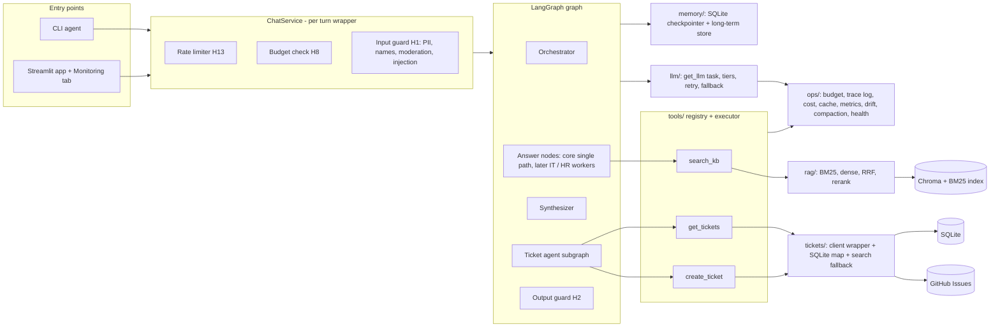

# PLAN.md: SmartDesk AI architecture and build plan

Source of truth: `SPEC.md` (draft v3, approved). This plan designs against it. Section 9 lists the spec issues found against draft v2; all are resolved in v3 and kept as a record of why. The core milestone (10-18) is SPEC sections 3A to 3G.
Today is 2026-10-13. Core target 10-18, deadline 10-23. Library-specific API claims below (LangGraph, Langfuse, LangSmith, Ragas, OpenAI params) are from memory and must be verified in the Phase 0 spike, not assumed.

---

## 1. Design principles

1. **Core first, fan-out later.** The graph is built around `parts: list[SubQuestion]` from day one. In core the orchestrator emits exactly one part (prompt `orchestrator_v1`); multi-part and `Send` fan-out arrive with `orchestrator_v2` (section 3I) without reshaping state or nodes. The core KB node is the same function (`answer_part`) the IT/HR workers later call.
2. **Everything external sits behind an interface with a mock.** LLM, embeddings, reranker, GitHub, Redis, Presidio, tracing. `LLM_MODE=mock`, `TICKETS_MODE=mock` (config/env) select fakes. `pytest` never touches the network (CLAUDE.md).
3. **Guards live in code, not prompts.** The executor enforces confirmation, schema, email validity, retries and dedupe (FR-G3 to G6). The graph enforces the one interrupt (FR-G12).
4. **Privacy at the sinks.** Redaction runs on input (before graph, checkpointer, LLM) and again in the trace/log layer (FR-G11, H1, H9).
5. **Degrade, never crash** (FR-F7): each optional component registers itself in `ops/health.py`; the Monitoring tab reads that registry.

---

## 2. Component architecture



**Layering (import direction, to avoid cycles):** `config` -> `guardrails/pii,names` (leaf, no LLM) -> `ops` -> `llm` -> `guardrails/input,output` -> `rag`, `tickets` -> `tools` -> `agent` -> `ui`. `ops/tracelog` may import only `guardrails.pii` and `guardrails.names` (keep `guardrails/__init__.py` empty).

**SQLite files** (under gitignored `data/`): `checkpoints.db` (LangGraph saver, owns its tables) and `app.db` (email-ticket map, long-term memory, cost/budget ledger, rate-limit counters, tool-call log, stale flags, drift runs). WAL mode plus a write lock, because fan-out nodes log concurrently.

---

## 3. Module interfaces

Signatures only. Pydantic models for every boundary (CLAUDE.md).

### 3.1 `config/` (`env.py`, `settings.py`), `config.yaml`
```python
class Settings(BaseModel): ...      # models, tier map, prices, windows, thresholds, prompt versions, modes
def load_settings(path: Path = ...) -> Settings   # config.yaml + env overrides; cached
```
`config.yaml` keys (FR-H16): `models.{main,light}`, `reasoning_effort`, `task_tiers{}`, `context_windows`, `prices`, `budget.{cutoff1,cutoff2,timezone}`, `rate_limits.{questions,creates,lookups,window_s,bypass}`, `compaction.trigger_pct`, `retrieval.{k_each=20,rrf_k=60,top_n=5,escalation_threshold,fallback_threshold}`, `routing.confidence_threshold`, `cache.{semantic_cutoff,enabled}`, `input.max_chars`, `prompts{name: version}`, `modes.{llm,tickets}`.

### 3.2 `llm/`
```python
class Task(StrEnum): ORCHESTRATOR; WORKER_ANSWER; SYNTHESIZER; GROUNDING_JUDGE; TOOL_SELECT; TICKET_DRAFT; INJECTION_CLASSIFIER; COMPACTION   # + CONFIRM_PARSE, CHITCHAT (flag F-11)
class Tier(StrEnum): MAIN; LIGHT
def get_llm(task: Task, *, agent: str, ctx: CallContext) -> BaseChatModel
def get_embeddings() -> Embeddings
```
`get_llm` returns a wrapper that, **at call time**: resolves tier (task map -> budget cutoff 1 forces LIGHT -> outage fallback to the other tier), retries with backoff, calls the fallback tier on exhaustion, raises `LLMUnavailable` if both fail, and writes one `LlmRecord` to `ops.trace_log` (agent, prompt name+version, prompt/completion redacted, model, tier, tokens in/out, latency, session, masked user, cost). Files: `sd/llm/factory.py` (`get_llm`), `tiers.py` (`Task`, `Tier`, map), `retry.py`, `fallback.py`, `fake.py` (scripted `FakeChatModel` that also records the exact messages it received, used to prove worker context isolation).

### 3.3 `rag/`
```python
class Chunk(BaseModel): chunk_id; entry_id; domain; title; header; text; source_file
class ScoredChunk(BaseModel): chunk: Chunk; score: float; stage: str
def parse_kb_file(path) -> list[Entry]
def chunk_entry(e: Entry, strategy="heading") -> list[Chunk]      # also "fixed512" for FR-A17
def ingest(kb_dir, *, strategy="heading") -> IngestReport          # idempotent; hash per file; flags stale; prunes orphans
def bm25_search(q, k, domain=None) -> list[ScoredChunk]
def dense_search(q, k, domain=None) -> list[ScoredChunk]
def rrf(lists: list[list[ScoredChunk]], k=60) -> list[ScoredChunk]
def weighted_fusion(lists, weights) -> list[ScoredChunk]           # ablation only
class Reranker(Protocol): def rerank(q, cands, top_n) -> list[ScoredChunk]
class CrossEncoderReranker; class NoopReranker                     # Noop = RRF order (FR-F7)
def retrieve(q, domain=None, cfg=...) -> RetrievalResult            # {chunks, top_score, score_kind, answerable, signals}
```
Each stage is a plain function so `evals/` can call any subset (FR-A6, A7).
Files: `sd/rag/kb_schema.py` (`Entry`, validator), `chunking.py` (`chunk_entry`), `ingest.py`, `staleness.py` (file hashes, stale flags), `retrievers.py` (`bm25_search`, `dense_search`), `fusion.py` (`rrf`, `weighted_fusion`), `rerank.py` (`Reranker`, `CrossEncoderReranker`, `NoopReranker`, entry collapse), `answerable.py` (signals 1-2), `pipeline.py` (`retrieve`).

### 3.4 `tickets/`
```python
class Category(StrEnum): IT; HR; MISC
class Priority(StrEnum): LOW; MEDIUM; HIGH; CRITICAL
class TicketStatus(StrEnum): OPEN; IN_PROGRESS; RESOLVED; CLOSED
class TicketClient(Protocol):
    def create(self, d: TicketCreate) -> Ticket
    def get(self, number: int) -> Ticket
    def latest_update(self, number: int) -> str | None
    def find_by_request_id(self, request_id: str) -> Ticket | None   # uses list-issues, not search (flag F-03)
    def search_by_email(self, email: str) -> list[Ticket]
class GitHubRestClient; class MockTicketClient                       # GitHubMcpClient only if time allows
class TicketMap:  add(email, number, request_id); numbers_for(email); backfill(email, numbers)
def find_tickets(email, client, tmap) -> list[Ticket]                # map first, search fallback + backfill (FR-C11)
def derive_status(state: str, labels: set[str]) -> TicketStatus      # FR-C6
```
Files: `sd/tickets/github_client.py` (`TicketClient`, `GitHubRestClient`, `MockTicketClient`, body/label building), `schemas.py` (enums, models), `sqlite_map.py` (`TicketMap`), `search_fallback.py` (`find_tickets`), `status.py` (`derive_status`).
Ticket body is built in one place: description, then `Employee: <email>`, then `Request-ID: <uuid>` (FR-B11, G6).

### 3.5 `tools/`
```python
class ToolSpec(BaseModel): name; description; args_model: type[BaseModel]; fn: Callable; allowed_agents: set[str]
REGISTRY: dict[str, ToolSpec]       # search_kb, create_ticket, get_tickets
class ToolResult(BaseModel): ok; data; error: ToolError | None; attempts: int; latency_ms
def execute(call: ToolCall, *, caller: str, ctx: ExecContext) -> ToolResult
```
Files: `sd/tools/definitions.py` (`ToolSpec`, arg models), `registry.py` (`REGISTRY`), `executor.py` (`execute`), `search_kb.py`. `execute` order: caller allowed -> validate args (no retry) -> tool guards (`create_ticket` needs `ctx.confirmation` token set only by the confirm node; email valid) -> up to 3 attempts, transient errors only, short backoff -> before any *retry* of `create_ticket`, `find_by_request_id` -> unavailable error -> metrics row (tool, agent, outcome, attempts, per-attempt and total latency, masked args). `search_kb` returns `{chunks, scores, answerable}` (FR-G7).

### 3.6 `guardrails/`
```python
class PiiRedactor: redact(text, *, keep_emails=True) -> Redacted      # Presidio, regex fallback (F7)
def reduce_names(text) -> str                                         # "John Doe" -> "John D."
def mask_email(email) -> str                                          # salted hash + domain-free; used by logs/traces
class InputGuard: check(text, ctx) -> GuardResult                     # {allowed, text, reason, flags}
class OutputGuard: grounding(answer, chunks) -> GroundingVerdict; finalize(reply) -> str   # moderation + PII scan
```
Files: `sd/guardrails/pii.py` (`PiiRedactor`, `mask_email`), `names.py` (`reduce_names`), `injection.py`, `input_guard.py` (`InputGuard`), `output_guard.py` (`OutputGuard`; the grounding judge itself runs inside `agent/answer.py`, FR-H2).

### 3.7 `ops/`
`budget.py` (`BudgetGuard.level() -> 0|1|2`, `record(cost)`; persisted per day in `app.db`), `cost.py` (price table, per-request/task/agent/tier/step cost), `rate_limit.py` (`RateLimiter.check(kind, key) -> Allowed | Denied(wait_minutes)`), `trace_log.py` (local sink + optional Langfuse/LangSmith sinks, masked), `tracing.py` (optional Langfuse/LangSmith sinks with masking), `metrics.py`, `hitl_counters.py`, `drift.py`, `compaction.py` (`maybe_compact(state) -> StatePatch`), `cache.py` (`AnswerCache` Protocol; `RedisCache`, `InMemoryCache`; `get/put/clear`), `health.py` (`register_degraded(component, reason)`).

### 3.8 `memory/`
`checkpointer.py` (`make_checkpointer(path)`), `long_term.py` (`LongTermStore.record_ticket(email, number, category)`, `.recall(email) -> list[int]`, `.last_category(email)`).

### 3.9 `agent/`
```python
class Deps(BaseModel): settings; llm_factory; tools; ticket_client; stores; ...   # DI container; mock vs live
def build_graph(deps: Deps) -> CompiledStateGraph
class ChatService:
    def handle(self, session_id: str, text: str) -> ChatReply    # the per-turn pipeline, section 5
def load_prompt(name: str) -> Prompt                              # {text, version}; version from config
```
Files (`sd/agent/`): `state.py`, `intents.py`, `router.py` (routing, scope boundary), `orchestrator.py`, `answer.py` (`answer_part`: answer, citations, grounding judge), `workers.py` (IT/HR worker nodes calling `answer_part`), `synthesizer.py`, `ticket_agent.py` (ticket flow), `confirm.py` (approval gate parse), `status_flow.py`, `chitchat.py`, `graph.py`, `chat_service.py`, `prompt_loader.py`, `__main__.py`, `prompts/*_vN.md`.

### 3.10 Layout additions needing approval (SPEC section 6 is silent)
`sd/config/` package (`env.py`, `settings.py`), `agent/__main__.py` (CLAUDE.md `python -m smartdesk_ai.agent`), `agent/chat_service.py`, `agent/prompt_loader.py`, `ops/health.py`, `evals/run.py` (`python -m evals.run`), `scripts/setup_labels.py` (FR-B11 "labels created once"), `spikes/` (Phase 0 throwaway scripts), `data/` (gitignored). `sd/` stands for `smartdesk_ai/`.

---

## 4. LangGraph design

### 4.1 State (`AgentState`, Pydantic model, checkpointed per `thread_id = session_id`)
| Field | Type | Notes |
|---|---|---|
| `messages` | `Annotated[list[AnyMessage], add_messages]` | already redacted, names reduced |
| `summary` | `str` | running compaction summary (FR-H5) |
| `email` | `str \| None` | validated; set by regex extraction, never guessed (FR-B13) |
| `last_topic` | `str \| None` | FR-D2 |
| `awaiting` | `None \| offer_reply \| email \| ticket_pick` | dialog state for non-interrupt turn ends (flag F-10) |
| `intent` | `IntentResult{intent, confidence, route_source}` | FR-D1, D8 |
| `parts` | `list[SubQuestion{part_id, text, domain}]` | core: length 1 |
| `part_results` | `Annotated[dict[str, PartResult], merge_by_key]` | keyed merge so the whole-KB retry overwrites, never duplicates |
| `PartResult` | `{answer, citations, chunks+scores, answerable, signals{no_chunks, low_score, llm_insufficient, ungrounded}, retried}` | |
| `pending_offer` | `{unanswered_text} \| None` | ticket offered, not yet accepted |
| `ticket` | `TicketDraft \| None` | `{request_id, email, title, description, category, priority, phase, confirmed, issue_number, url}` |
| `status_candidates` | `list[TicketRef]` | FR-C3 pick list |
| `reply` | `str` | |
| `cache_hit`, `steps`, `errors` | misc | `steps` feeds steps-to-completion (FR-H11) |

### 4.2 Nodes
| Node | Does | LLM tier |
|---|---|---|
| `prepare` | extract/validate email (regex), compaction check (H5), long-term recall when an email first appears (H10) | Light (compaction only) |
| `orchestrate` | one structured call: intent + confidence + parts (rewritten standalone, domain-tagged); sees `awaiting` | Main |
| `tool_pick` | fallback route when classifier errors/invalid/low-confidence (FR-D8); binds the three tool schemas | Light |
| `chitchat` | smalltalk, out_of_scope deflection, or one clarifying question; no tool | Light (flag F-11) |
| `cache_lookup` / `cache_store` | KB answers only, keyed on the rewritten sub-question (flag F-06) | embedding only |
| `kb_answer` (core) = `answer_part(part, domain=None)` | `search_kb` via executor -> answer from chunks only, citations, `llm_insufficient` flag -> grounding check | Main (+ judge Main) |
| `it_worker`, `hr_worker`, `misc_search` (bonus) | same `answer_part` with domain filter / domain prompt, dispatched by `Send` | Main |
| `retry_gate` | for each unanswerable part not yet retried: `Send` to `kb_retry` (no domain filter); else continue | none |
| `kb_retry` | `answer_part(part, domain=None)` with a neutral prompt | Main |
| `compose` | 1 part -> pass-through (no LLM); 2+ parts -> `synthesize` (FR-I5, I7); appends ticket offer for unanswered parts and sets `pending_offer`, `awaiting=offer_reply` | Main (multi only) |
| `t_collect` | ensure valid email (else ask, `awaiting=email`), merge `pending_offer.unanswered_text` | none |
| `t_dup_check` | duplicate-request check (FR-F4, flag F-14) | none |
| `t_draft` | title, description (conversation summary, unanswered part only), category, priority | Light |
| `t_confirm` | **the only `interrupt()`**; parses the resume reply into yes / no / edit / unclear | Light (flag F-11) |
| `t_apply_edit` | updates draft, loops back to `t_confirm` | Light |
| `t_create` | `execute(create_ticket)` with confirmation token; stores map row + long-term row | none |
| `t_reply_created` / `t_cancel` | exact ID/link/status from the response only (FR-B9, B13) | none |
| `s_lookup` | email check -> `execute(get_tickets)` -> 0 / 1 / 2+ branch | none |
| `s_detail` | ID, title, status, latest team update; for 2+ resolves `ticket_pick` | none |
| `output_guard` | Moderation, PII scan, Pydantic validation of reply; final masked trace write | none |

### 4.3 Edges

`retry_gate` is the join point for the `Send` fan-out; the keyed `part_results` reducer makes the retry loop idempotent.

### 4.4 Interrupt and turn-end points
| Point | Mechanism | Resumes with |
|---|---|---|
| `t_confirm` | LangGraph `interrupt()`, SQLite checkpointer, survives restart (FR-G12) | `Command(resume=<user text>)` |
| Ticket offer after a gap | normal turn end, `awaiting=offer_reply` | next turn; orchestrator reads `awaiting` |
| Email request | normal turn end, `awaiting=email` | next turn |
| Status pick list | normal turn end, `awaiting=ticket_pick` | next turn |

Interrupt rules: `t_confirm` contains only the interrupt and the parse (LangGraph re-runs a node from its top on resume, so no side effects before the interrupt). `ChatService` detects a pending interrupt with `graph.get_state(config).next` and resumes instead of invoking. Rate limiting and input guards run on resume messages too, because they sit in `ChatService`, not in the graph.

---

## 5. Data flow

**Per turn (`ChatService.handle`)**
1. Rate limit: question counter (counts every message, FR-H13). Denied -> "Usage limit reached... N minutes".
2. Budget level: level 2 -> "service temporarily unavailable", no LLM call.
3. Input guard: length/empty (F4), PII redaction (email kept), name reduction, Moderation, injection (heuristics, then LLM classifier). Blocked -> polite refusal, reason logged, no graph run.
4. Graph `invoke` or `resume` (`thread_id = session_id`); redacted text only enters state and the checkpointer.
5. `output_guard` inside the graph; `ChatService` returns `ChatReply{text, ticket?, debug}`.
6. Trace log: request, steps, tool calls, LLM calls, cost, all masked.

**KB answer.** orchestrate -> cache_lookup -> `search_kb` (BM25 top-20 + dense top-20 -> RRF k=60 -> dedupe -> rerank -> top-5; threshold on reranker score, fallback threshold on dense similarity if the reranker is down) -> answer from chunks with citations -> grounding judge -> `retry_gate` (one whole-KB retry) -> compose -> cache_store -> output_guard.

**Escalation.** Any of: zero chunks, score below threshold, `llm_insufficient`, ungrounded -> one whole-KB retry -> still failing -> "I don't know" plus one merged message offering a ticket and asking for the email (FR-A16), `awaiting=offer_reply`. Giving the email or saying yes enters `t_collect`; a refusal clears `pending_offer`.

**Ticket.** t_collect -> t_dup_check -> t_draft -> **interrupt** -> yes: `execute(create_ticket)` (request_id in body, confirmation token) -> map row + long-term row -> reply with returned ID/link/status only.

**Status.** s_lookup -> `get_tickets` (SQLite map -> GitHub fetch; if the map is empty, search `Employee: <email>`, backfill) -> 0 / 1 / 2+ -> `derive_status` -> latest comment.

**Cross-session recall (H10).** New thread + known email -> `prepare` pulls ticket numbers from the long-term store, then fetches title/status live from GitHub. No message history crosses threads.

---

## 6. Test and mock strategy

* `LLM_MODE=mock`: `FakeChatModel` with scripted structured outputs per prompt name; deterministic hash embeddings; `FakeReranker`. `TICKETS_MODE=mock`: in-memory `MockTicketClient` that can inject transient failures and lost responses. Real-model tests (reranker, Presidio+spaCy, real OpenAI/GitHub) use `@pytest.mark.integration`, skipped by default, and need your explicit go-ahead (CLAUDE.md).
* Test-first per task; each test cites its FR ids. Evals data (SPEC section 7) is written before the code it tests.
* Threshold tuning uses a dev/test split of the KB and gap sets (flag F-17).

---

## 7. Build phases mapped to FR IDs

Every phase ends with `pytest` green and TASKS.md updated. One TASKS.md task at a time (CLAUDE.md). TASKS.md is generated from this section after approval.

| # | Phase | Dates | FRs | Exit criterion |
|---|---|---|---|---|
| 0 | Scaffold + spikes | 10-13 to 10-14 | F3, F5, F6 (skeleton), F7 (health registry), H14 (prompt loader), H16 (config) | `pip install`, `pytest` runs, app starts with no keys. Spikes: LangGraph interrupt + SqliteSaver + Pydantic state + `Send`; Langfuse/LangSmith masking hooks; one real `gpt-5.4-mini` call for param check (needs your OK) |
| 1 | KB + eval data | 10-13 to 10-15 | A1, A2, A8, A9, A10, A18; SPEC section 7 sets (kb, gap, intents, categories, compound, scenarios, safety) | 30+ entries (aim 50), 40+ KB Qs, 15+ gaps, 30+ intents, `GAPS.md`, `SOURCES.md` (flag F-21). LLM-generated content costs money: confirm first |
| 2 | RAG | 10-14 to 10-16 | A3, A5, A6, A7, A11, A12, A15 (signals 1-2), A17, H6, F7 (reranker fallback) | ingest twice -> same chunk count; Recall@k table for 4 strategies; chunking ablation; threshold tuned |
| 3 | LLM, tools, tickets | 10-15 to 10-17 | H17 (map + `get_llm`), F2, G1, G3, G4, G5, G6, G7, G9, B3, B10 to B13, C2, C6, C8 to C11, F1 | executor tests: retry x3, no retry on bad args, no create before confirmation, lost response no duplicate; seed script idempotent (mock first, live after confirm) |
| 4 | Single-path agent (**core milestone**) | 10-16 to 10-18 | H10 (SQLite checkpointer, first task), A4, A13, A14, A15 (signal 3), A16, A19 (trivial: core searches whole KB), B1, B2, B4, B5 to B9, C1, C3 to C5, C7, D1 to D9, F4, G2, G12 | flows A/B/C scripted; 0/1/2+ status; confirm yes/no/edit; routing set; CLI `--debug` shows chunks and scores (A12) |
| 5 | Safety + ops (core-mapped) | 10-18 to 10-19 | H1, H2, H3, G8, G11, H5, H7, H8, H9, H13, F7 (Presidio fallback) | safety set: leakage 0, breach 0; budget and rate-limit ACs; masked logs. *Spills past 10-18, flag F-20* |
| 6 | Evals, UI, cache (bonus 1 to 4) | 10-19 to 10-21 | H11, H12, H15, G10, H4, cache AC (section 4), H17 comparison | `python -m evals.run` produces Ragas + ablation tables; Streamlit chat + Monitoring tab; cache AC passes with and without Redis |
| 7 | Multi-agent (bonus 5) | 10-21 to 10-22 | I1 to I9, A19 (full), H17 | compound / gap-part / misroute / MISC ACs; worker inputs contain only the sub-question |
| 8 | Long-term memory (bonus 6) | 10-22 | H10 (long-term store and cross-session recall only; the checkpointer moved to Phase 4) | cross-session recall AC |
| 9 | Docs + delivery | 10-22 to 10-23 | E (README, diagram, results), B10 note, `load_test.py` (H11 throughput), section 8 deliverables, demo video | README complete; video recorded with memory clip |

Coverage check: A1 to A19, B1 to B13, C1 to C11, D1 to D9, F1 to F7, G1 to G12, H1 to H17, I1 to I9 each appear in at least one phase.

**Schedule risk:** 10 days for everything. If behind, cut in this order: stretch (SPEC section 5), GitHub MCP, LangSmith *or* Langfuse (keep one), semantic cache (keep exact-match), multi-agent fan-out (keep single-path), drift chart.

---

## 8. Single-path to multi-agent switch

Core `orchestrator_v1` always returns one part with `domain=None`; `kb_answer` runs `answer_part(part, None)`. Phase 7 swaps in `orchestrator_v2` (multi-part, domain tags), adds `it_worker`/`hr_worker`/`misc_search` as `Send` targets, adds `synthesize`, and moves the retry from "none needed" to the real `retry_gate` path. State, executor, guards, ticket subgraph and `ChatService` do not change.

---

## 9. Spec issues found against v2 (all resolved in SPEC v3)

### 9.1 Contradictions (need decision)

* **F-01. Compaction summarizer vs window (FR-H5, H17).** Compaction triggers at 75% of the active window (300k tokens for Main, 96k for Light) but the summary task runs on Light-Model, whose window is 128k. 300k tokens cannot be sent to it. *Proposal:* summarize in slices that fit Light, or use Main when the input exceeds Light's window. Also, real help-desk chats never reach 300k, so the AC needs test-only small windows via config. *Blocks Phase 5.*
* **F-02. Dedupe by `entry_id` vs split chunks (FR-A6 vs A3, AC).** Entries over ~600 tokens are split into pieces that share `entry_id`; dedupe by `entry_id` would drop pieces, while the AC speaks of "chunk ID". *Proposal:* dedupe by `chunk_id` before rerank, then collapse to entry (best piece wins) after rerank and give the LLM the full parent entry. *Blocks Phase 2.*
* **F-03. Lost-response protection uses a lagging search (FR-G6 vs C11).** G6 checks "whether an issue with that request ID exists" before a retry, but C11 notes GitHub search lags about a minute, so a just-created issue is missed and a duplicate is created. *Proposal:* check with the list-issues endpoint (consistent), plus a request-ID row written to SQLite before the call. *Blocks Phase 3.*
* **F-04. Long-term store fields vs recall AC (FR-H10).** The store holds "past ticket numbers, last category, preferred contact method, and nothing else", but the AC recalls ID, title, **status**. Title/status are not allowed fields. *Proposal:* store numbers only and fetch title/status live. Also, nothing in the spec ever collects "preferred contact method"; *proposal:* drop it. *Blocks Phase 8.*
* **F-05. MISC path vs synthesizer definition (FR-I2 vs I3, I5).** I2 says "the synthesizer answers if a match passes" for MISC, but I3 defines the synthesizer's input as worker outputs, and there are none for MISC. *Proposal:* MISC runs the same `answer_part` with no domain filter (a worker without a domain); the synthesizer only merges multi-part results. *Blocks Phase 7.*
* **F-06. Cache AC vs conversational context (section 4 cache AC vs D6/I3).** "Repeated question = cost 0, no LLM call" cannot hold: intent and rewrite need the orchestrator, and caching raw text breaks follow-ups ("what about sick leave?"). Semantic hits also need an embedding call, so "cost 0" is not exact (FR-H7). *Proposal:* key the cache on the rewritten standalone sub-question; a hit skips retrieval, the worker and the judge (reword the AC accordingly); embedding cost counted. *Blocks Phase 6.*
* **F-07. Topic filter ordering (FR-H1 vs D8).** H1 says input guardrails (including the intent-check topic filter) run *before* the graph, but intent classification is the orchestrator's job inside the graph. *Proposal:* pre-graph guard does PII, names, Moderation, injection only; the topic filter *is* the orchestrator's `out_of_scope` result (FR-D9), no second classifier call. *Blocks Phase 5.*
* **F-08. Fallback routing cannot reach all intents (FR-D8, G1, G2).** The tool-pick fallback only exposes `search_kb` / `create_ticket` / `get_tickets`, so on classifier failure smalltalk, out-of-scope and ambiguous cannot be selected, and G1 says ticket tools are used only by the ticket agent. *Proposal:* the fallback maps tool pick to route (search_kb -> kb_query, etc.), and "no tool" -> `chitchat`; the tool pick is made by the orchestrator for routing only, execution still goes through the ticket agent. *Blocks Phase 4.*
* **F-09. Budget cutoff vs outage fallback (FR-F2 vs H8).** If budget level 1 forces everything to Light and Light fails, F2 says fall back to Main, which violates the budget. Also falling back Main -> Light can overflow Light's smaller window. *Proposal:* at level >= 1 no fallback to Main; check prompt size before a Main -> Light fallback. *Blocks Phase 3.*

### 9.2 Unclear (propose and proceed unless you object)

* **F-10. Dialog state between turns.** The spec says the offer, email request and pick list end the turn but never says how the next "yes" or "the second one" is routed. *Proposal:* an `awaiting` state field passed to the classifier. Also undefined: user changes topic mid-flow (*proposal:* new intent wins, pending offer cleared), and an unrelated or unclear reply at the confirmation gate (*proposal:* re-ask once, then cancel, never create).
* **F-11. Where the confirmation reply is parsed.** G12 needs yes / no / edit; no task in the H17 tier map covers it (and none covers small talk replies). *Proposal:* add `CONFIRM_PARSE` and `CHITCHAT` to the map on Light-Model; exact "yes"/"no" short-circuit without a call. **This is a spec change to the H17 table.**
* **F-12. Worker tool-pick call (FR-G2, I3).** G2 has the model choose the tool inside a route, but a worker has exactly one tool and a fixed domain. A tool-pick LLM call per worker adds latency and cost for no gain. *Proposal:* workers call `search_kb` deterministically through the executor; the model chooses tools only in the fallback (F-08) and in the ticket agent.
* **F-13. Grounding check placement for multi-part answers (FR-H2, I5).** H2 checks "the answer's claims against retrieved chunks" on every reply; for synthesized replies that means the union of chunks. *Proposal:* run the judge once per part (inside `answer_part`), so an ungrounded part feeds the retry/offer path (H2 intent); the final `output_guard` does Moderation, PII and schema only.
* **F-14. "Duplicate ticket request" (FR-F4).** Behaviour undefined. *Proposal:* if the same email already has an open ticket with a near-identical title, tell the employee and ask whether to open another. Separate from request-ID dedupe (G6).
* **F-15. Priority: optional or asked? (FR-B1 vs B7).** *Proposal:* infer, show it in the summary, do not ask a separate question (fewer turns); the employee can edit at the gate.
* **F-16. Offer wording with a known email (FR-A16).** "Giving the email counts as agreeing" does not cover the case where the email is already known. *Proposal:* then the offer is a plain yes/no question.
* **F-17. Threshold tuning leakage (FR-A5, section 9).** Tuning the escalation threshold on the same KB and gap sets used for the final pass-rate numbers overstates results. *Proposal:* dev/test split of both sets.
* **F-18. Reranker score scale (FR-A15).** bge-reranker outputs raw logits, not 0 to 1, and the fallback threshold is on cosine similarity: two different scales. *Proposal:* sigmoid-normalize reranker scores; keep two config thresholds, each tied to its `score_kind`.
* **F-19. Entry metadata location (FR-A1, A8).** "Front matter" with `id`, `domain` per `##` entry, yet IT equipment allocation sits inside an otherwise HR onboarding file, so domain is per entry, not per file. *Proposal:* a YAML block directly under each `##` heading; file-level front matter only for the policy area.
* **F-20. Core vs ops placement (CLAUDE.md vs SPEC 3H).** CLAUDE.md defines core as 3A to 3F, but SPEC section 10 maps H1, H2, H3, H8, H13 into Robustness (core marks) while most of H is bonus-ish. They cannot all land by 10-18. *Proposal:* Phase 4 ships no-op guard hooks in `ChatService` so Phase 5 plugs in without graph changes; the 10-18 "core" milestone is 3A to 3G, with H1/H2/H3/H8/H13 due 10-19.
* **F-21. Public-dataset sourcing vs "own work".** FR-A10 adapts public HR datasets while CLAUDE.md requires own work and plagiarism checks run. *Proposal:* record each source and its license in `kb/SOURCES.md` and rewrite rather than copy. Your call on whether that is enough.
* **F-22. Budget vs evals (FR-H8, H13).** Rate limits bypass for evals; the daily $10 cutoff does not, and Ragas judge runs plus ablations could hit it. *Proposal:* separate eval budget flag in config, off by default for the agent, and judge costs tracked separately.
* **F-23. Rate-limit keys and persistence (FR-H13).** "Keyed by session ID (and by email for ticket lookups)" is ambiguous (both keys, or either?), "ticket creations" may mean attempts or successes, and persistence across restart is unstated. *Proposal:* lookups keyed by session AND email, creations count successes at the gate, counters in `app.db`.
* **F-24. Drift button cost (FR-H15).** The Monitoring button spends real money (Ragas judge). *Proposal:* confirmation dialog showing estimated cost (CLAUDE.md "confirm before real calls").
* **F-25. Injection classifier cost (FR-H1).** An LLM call on every message is wasteful. *Proposal:* run the LLM classifier only when the heuristic score is above a low threshold.
* **F-26. Input limits (FR-F4).** "Very long input" has no number. *Proposal:* `input.max_chars` in config (start at 4000).
* **F-27. Status mapping gap (FR-C6).** An open issue carrying `resolved`, or both status labels, is undefined. *Proposal:* open + `in-progress` wins -> In Progress; open + `resolved` only -> Open.
* **F-28. Tracing auto-capture vs masking (FR-G11).** LangChain callbacks send full inputs (with raw emails) to LangSmith/Langfuse before our redaction. *Proposal:* use each SDK's input/output masking hook, verified in the Phase 0 spike; if it cannot be guaranteed, send only our own redacted spans.
* **F-29. Raw email persistence.** The checkpointer and long-term store necessarily hold raw emails (they are data stores, not logs). Treated as allowed under G11; say so if you disagree.
* **F-30. Name reduction false positives (FR-H1).** Presidio PERSON detection will hit product and place names; KB owner names in retrieved chunks could be mangled by the output PII scan. *Proposal:* names only reduced on user input; output scan only redacts non-name PII.
* **F-31. Models, prices and params unverified.** Model IDs, prices and `reasoning_effort="none"` come from SPEC (checked 10-12). I cannot verify them here; all are config-only. Phase 0 spike checks them with one real call, after your OK.
* **F-32. Ragas metric names and versions.** `AnswerCorrectness`, `FactualCorrectness`, Faithfulness differ between Ragas versions. Pin a version in Phase 0 and adjust FR-H12 wording if a metric is missing.
* **F-33. Minor.** Architecture diagram is required in both README (E) and `docs/architecture.md` (section 6): keep one source and embed. Re-ingest should prune chunks of deleted entries (FR-A11/H6 silent). Cache clears at re-ingest (H6) vs "whenever the KB changes" (section 4): treat as the same event.

---

## 10. Verification (how each layer is checked end to end)

1. `pytest` (mock mode, no network) after every task.
2. Phase 2: `python -m smartdesk_ai.rag.ingest` twice, same count; `python -m evals.run --only retrieval` prints the Recall@k table.
3. Phase 4: scripted flows A/B/C in mock mode; then, with your approval, one live run: CLI chat, create one ticket in the tickets repo, check status.
4. Phase 5: safety set run -> leakage 0, breach 0; grep logs/traces for raw email.
5. Phase 6: `streamlit run smartdesk_ai/ui/app.py`, Monitoring tab shows tool stats, degraded modes, cost by tier.
6. Phase 9: fresh clone -> `pip install -r requirements.txt` -> run with no tracing keys and no Redis.

Anything that spends API money or creates public issues is confirmed with you first.

## 11. After approval

Status: SPEC.md is draft v3 and approved. Section 9 is resolved: every item was either applied to SPEC.md or answered by the approved v3 text, and the core milestone is sections 3A to 3G (SPEC section 9, CLAUDE.md "Core first"). `TASKS.md` is derived from section 7 (one task per row item, each with FR ids, files, and its acceptance test). No code and no commits until you say which task to start.

## 12. Phase 0 spike notes

- **openai pin (T0.1).** `requirements.txt` pins `openai==3.3.0`, not the newest 3.31.0, because `ragas==0.4.3` pulls in `instructor`, whose releases need `jiter<0.15`, while `openai 3.31.0` needs `jiter>=0.16`. T0.9 must confirm 3.3.0 handles `gpt-5.4-mini` and `reasoning_effort`. Fallback if it cannot: move Ragas and its deps into a separate `requirements-eval.txt` so the app can use a newer `openai`. Not done now.

### 12.1 T0.7 LangGraph spike findings (langgraph 1.2.15, checkpoint 4.3.0, checkpoint-sqlite 3.1.2)

Spike: `spikes/langgraph_spike.py`, tests in `tests/test_spike_langgraph.py` (12 tests, no network, no LLM). The graph is a slice of section 4.3: `plan` -> `Send` fan-out to `worker` -> `retry_gate` (join and retry loop) -> `confirm` (the only `interrupt()`) -> `create` / `cancel`, with `edit` looping back to `confirm`.

**What worked as PLAN assumes**
- **Interrupt and resume across processes.** The graph pauses at `interrupt()`. A separate Python process opens the same SQLite file and resumes with `Command(resume=<text>)` and the same `thread_id`. `graph.get_state(config).next == ("confirm",)` detects a pending interrupt, as section 4.4 says. A finished thread has `next == ()` and cannot create twice.
- **Threads are independent** in one database; an unknown thread has empty `values` and `next == ()`.
- **Pydantic state** (`BaseModel` as the schema) works, including nested models, `add_messages`, and a custom keyed reducer. Models come back as models from `get_state().values` in another process.
- **`Send` fan-out joins.** Workers in one superstep all finish before `retry_gate` runs, so `retry_gate` is the join point. A conditional edge from `retry_gate` can return `list[Send]` (retry) or a node name (continue). The retry loop ran as designed: `plan, worker x3, retry_gate, worker, retry_gate`.
- **Keyed `part_results` reducer** is idempotent: the retry overwrites `p3`, and there are still exactly three keys.
- **Edit loop.** `confirm -> apply_edit -> confirm` raises a fresh interrupt on each pass; one `create` happens in total.

**Differences from PLAN**
- `graph.invoke(...)` does not raise on interrupt. It returns the state dict with an extra `"__interrupt__"` key, a list of `Interrupt` objects; the payload is `result["__interrupt__"][0].value`. `ChatService` should read that, not catch an exception.
- `SqliteSaver.from_conn_string(path)` is a context manager that closes the connection on exit. For a long-lived app (CLI, Streamlit threads), `make_checkpointer(path)` should build `SqliteSaver(sqlite3.connect(path, check_same_thread=False), serde=...)` itself and keep it open.
- A node reached by `Send` receives the `Send` payload (a dict), not the graph state. Workers must read `payload["part"]`.
- The node's own step is not recorded until it finishes, so a node stopped at an interrupt has no entry in a `steps` reducer yet.

**Gotchas**
1. **Nodes restart from the top on resume.** The `confirm_top` log line appears twice for one confirmation. Anything before `interrupt()` runs again, so `t_confirm` must hold only the interrupt and the parse (already in section 4.4). Side effects (`create`) ran exactly once.
2. **Allow-list Pydantic types in the serializer.** With the default serde, every load of a checkpoint logs `Deserializing unregistered type ... will be blocked in a future version`. Build the saver with `JsonPlusSerializer(allowed_msgpack_modules=[(module, class), ...])` for each model stored in state (`STATE_TYPES` in the spike). Add new state models to that list, or checkpoints stop loading once LangGraph enforces it. A test checks that no warning is logged.
3. **Do not run a module that defines state classes with `python -m`.** Classes are then tagged `__main__.X` in the checkpoint, and another process cannot resolve them (they come back as plain dicts). The real app defines state in an importable module (`smartdesk_ai.agent.state`), so this only affected the spike's CLI.
4. **`config["configurable"]` is persisted** in every checkpoint's metadata (verified in the SQLite file). Only `thread_id` may go there. Emails, names, tokens and other PII must never be passed through `configurable` (CLAUDE.md, FR-G11). Pass per-call dependencies through `Deps` closures instead. A test pins this behaviour.
5. **Checkpoints hold the full state.** Everything in `AgentState` (messages, drafts) is stored in SQLite, so only redacted text may enter state, as section 5 step 4 already requires.

**Not covered here** (later tasks): real LLM nodes, `Send` to differently-named worker nodes by domain (I4 bonus), `interrupt` with several pending interrupts in one superstep, checkpoint cleanup and size, and concurrent writers on one SQLite file.
