# 🧠 SmartDesk AI: a first-line IT and HR help desk agent that answers from a knowledge base, asks before it files a ticket, and checks ticket status

SmartDesk AI answers employee questions from a company knowledge base (KB) with citations, says "I don't know" instead of guessing, offers a ticket when the KB cannot help, creates the ticket only after the employee confirms it, and reports the status of their tickets. It is built with LangGraph, OpenAI models, ChromaDB plus BM25 plus a cross-encoder reranker, GitHub Issues as the ticket system, and a Streamlit UI with a Monitoring tab. The company, its policies and every email in this repo are fictional.



(Mermaid source: [`docs/architecture.md`](docs/architecture.md). PNG: [`docs/architecture.png`](docs/architecture.png).)

## 🚀 Quick Start

**Prerequisites**
- Python 3.12 and [uv](https://docs.astral.sh/uv/) (`uv python install 3.12` if 3.12 is missing)
- Optional: Redis for the shared answer cache (`brew install redis`); without it the cache is in memory
- About 1.1 GB of disk for the reranker model and about 425 MB for the spaCy model (see the [Appendix](#appendix-models-hardware-modes-and-setup))
- Optional, for live mode only: an OpenAI API key, and a GitHub fine-grained token plus a public tickets repo

```bash
git clone https://github.com/pbhat123/SmartDesk_AI.git && cd SmartDesk_AI

uv venv --python 3.12 .venv
source .venv/bin/activate
uv pip install -r requirements.txt            # the project pins everything in requirements.txt (there is no pyproject)
python -m spacy download en_core_web_lg       # spaCy model for Presidio (pip does not install it)

cp .env.example .env                          # fill in values only for live mode; mock mode needs none
python -m smartdesk_ai.rag.ingest --mock      # build the KB indexes offline (drop --mock for real embeddings, needs OPENAI_API_KEY)
python scripts/seed_tickets.py                # seed demo tickets (mock mode: in memory only; live needs --confirm-live)

streamlit run smartdesk_ai/ui/app.py          # the UI: Chat page and Monitoring page
python -m smartdesk_ai.agent --debug          # or the CLI chat; --debug shows retrieved chunks and scores
```

**Modes.** `config.yaml` ships with `modes.llm: mock` and `modes.tickets: mock`, so a fresh clone runs with no keys and no network. Switch one run without editing the file:

```bash
SMARTDESK_LLM_MODE=live SMARTDESK_TICKETS_MODE=mock streamlit run smartdesk_ai/ui/app.py   # real models, in-memory tickets
SMARTDESK_LLM_MODE=live SMARTDESK_TICKETS_MODE=live streamlit run smartdesk_ai/ui/app.py   # real models, real GitHub issues
```

Live mode that cannot start (a missing key or token) stops with a clear message; it never falls back to mock quietly.

**Tests, smoke test and evals**

```bash
scripts/install_hooks.sh                # once per clone, before pytest (a test checks it): the pre-commit hook runs pytest and, for UI changes, the smoke test
pytest                                  # about 2,850 unit tests, mock mode, no network, no spend (about 2.5 minutes)
python scripts/smoke_ui.py              # a real Streamlit server and browser, mock mode, temp data (about 15 s); needs Playwright and Chrome
python scripts/load_test.py             # mock-mode throughput and p50/p95 latency
python -m evals.run --mock              # every eval step offline and free (hashing embeddings, mock models)
python -m evals.post_phase7 --estimate  # prints the cost table of the live batch and stops without spending
# paid runs (estimate first, then approve; each needs --confirm-spend):
#   python -m evals.run --only gap --confirm-spend                                      # live gap + KB run
#   python -m evals.run --only rag --judge ragas --confirm-spend --out-dir evals/results   # Ragas judge
#   python -m evals.safety_eval --live --confirm-spend                                  # safety set with real Moderation
```

Anything that spends money prints an estimate first and needs `--confirm-spend` (live evals) or `--confirm-live` (public GitHub writes).

---

## 1️⃣ Project Title & Value Proposition

**SmartDesk AI** is the first line of an IT and HR help desk. Employees get an answer in seconds from the KB, with the policy entry cited, instead of waiting for a person. When the KB has no answer, the agent does not invent one: it offers to open a ticket, drafts it, shows the draft, and files it only after the employee says yes. Employees can ask for the status of their tickets in the same chat.

Value in numbers (live runs, details in section 9): 100% of questions the KB cannot answer end in "I don't know" and a ticket offer, 98.1% of answerable questions are answered with citations, no PII leaked and no policy breach on the 27-case safety set, and a scripted task costs about $0.002.

## 2️⃣ Background & Problem Context

IT and HR teams answer the same questions every day (reset a password, how many casual leave days, which VPN server). The answers exist in policy documents, but employees do not read them, so the questions land in a queue. The expensive part is not the answer: it is the person who has to read a vague request, find the policy, reply, or file and route a ticket.

A chatbot over documents has two well-known failure modes that matter more here than in a demo: it answers confidently when the policy does not say (a wrong leave rule is worse than no answer), and it takes actions (a ticket in a public tracker) without being sure the employee wants them. SmartDesk AI is designed around those two risks.

## 3️⃣ Target User & Job To Be Done (JTBD)

| User | Job to be done | What the agent does |
|---|---|---|
| Employee | "Tell me how to do X / what the policy says" | Answers from the KB with the entry ID, or says it does not know |
| Employee | "This is broken and I need a person" | Offers a ticket, drafts title, description, category and priority, files it after a yes |
| Employee | "Where is my request?" | Looks the tickets up by work email and shows status and the latest team update |
| IT/HR agent (person) | "Give me tickets that are complete and routed" | Receives tickets with category, priority and a conversation summary; nothing invented |
| Manager of the help desk | "Is the bot safe, accurate and affordable?" | Monitoring tab: cost, tool failures, approvals, drift, component health |

There is no login: an employee is identified by the work email given in the conversation (project FAQ Q19).

## 4️⃣ Why an Agentic Approach (Very Important)

A single prompt over documents cannot do this job, because the job is several different decisions in a row:

- **Decide what the message is.** A KB question, a ticket request, a status check, small talk, something out of scope, or several of these at once ("how do I reset my password, and how many casual leave days do I get?").
- **Pick the right knowledge.** IT and HR questions go to different specialists, in parallel when a message has both, and a wrong guess is retried once on the whole KB.
- **Use tools with side effects.** Searching the KB is free and repeatable; creating a ticket is not. The two are handled by different code paths with different rules.
- **Stop and ask.** The ticket flow pauses for a human decision (LangGraph `interrupt`), which survives a restart.
- **Know when not to answer.** A grounding check, a similarity threshold and the model's own "insufficient" signal can each send a question to the ticket offer.

A fixed pipeline would not branch like this; a free-running agent would not be safe to give a ticket tool. The design is a small set of agents with fixed roles, a router in front, and code-level guards around every tool.

## 5️⃣ Agent Role, Scope & Autonomy Level

**The agent may:** answer from the KB, ask for the employee's work email, draft a ticket, look up tickets, and politely refuse or deflect.
**The agent may not:** answer from outside the KB, create a ticket without an explicit yes, invent a ticket ID, URL, status or team update, or reveal another employee's tickets.

| Action | Autonomy |
|---|---|
| Answer a KB question | Autonomous (grounded and cited; checked by a grounding judge before it is shown) |
| Check ticket status | Autonomous, only for the email the employee gave |
| Create a ticket | **Human in the loop**: the draft is shown, the graph pauses on `interrupt()`, and only an explicit yes creates the issue. "Skip the confirmation" and "already confirmed" are treated as no confirmation. The employee can also edit the draft or cancel |
| Anything outside IT/HR help | Deflect politely; no ticket offer for out-of-scope questions |

Scope boundary: workplace gaps (parking, cafeteria, desk booking) are in scope and get a ticket offer; trivia, recipes and general coding help are not (FR-D9).

## 6️⃣ Agent Architecture & Components


- **ChatService** runs on every message, including the resume of a paused ticket: rate limits, budget cutoff, then the input guard (PII masking and name reduction, self-harm and threat rules, OpenAI Moderation, prompt-injection check).
- **Planner (orchestrator).** One structured call per turn returns the intent and confidence and rewrites the message into standalone, domain-tagged sub-questions. The intent classifier decides the route; the model's own tool pick is used only if the classifier errors or is unsure (FR-D8).
- **Workers.** The IT worker and the HR worker each answer only their sub-question, from retrieved chunks only, with citations. A MISC question (facilities and the like) goes to a no-domain search. Parts run in parallel with the LangGraph `Send` API. A part that cannot be answered is retried once on the whole KB (this also repairs misroutes), then marked unanswered.
- **Compose / synthesizer.** One part passes through unchanged (no extra model call). Two or more answered parts are merged by the synthesizer, which is checked against the worker answers (numbers, IDs, names) and replaced by the plain answers if it adds anything. Unanswered parts are named and a ticket for that part only is offered, in fixed wording.
- **Ticket agent.** Owns `create_ticket` and `get_tickets`, runs sequentially, and sits behind the approval gate.
- **Memory.** Short-term: LangGraph checkpointer on SQLite, keyed by `thread_id` only (nothing personal is stored in the config). Long-term: a separate SQLite store keyed by a salted hash of the work email, written after a confirmed ticket, so a new session with the same email can recall earlier tickets. The email-to-ticket map is a third, separate store (the map the status flow needs).
- **Tools** go through one registry and executor that adds retries and guards: `search_kb` (BM25 and Chroma dense retrieval, reciprocal rank fusion, bge-reranker-base) and the GitHub REST ticket client.
- **Output guard.** Pydantic validation, PII scan, Moderation, and the grounding verdict, on every reply.
- **Ops.** Answer cache (exact and semantic; Redis or in-memory), spend ledger and budget, masked traces (local log, Langfuse, LangSmith when keys exist), and the Monitoring tab.

## 7️⃣ End-to-End Agent Workflow

1. **KB question.** "How do I reset my forgotten password?" → guards → orchestrator (intent `kb_query`, one part, IT) → cache lookup → IT worker retrieves five entries and answers with `Sources: IT-PWD-01` → grounding judge passes → output guard → reply.
2. **Gap and ticket.** "Is there a parking spot for my motorbike?" → no entry passes the checks → reply says the KB does not cover it and offers a ticket, asking for the work email → email given → duplicate check → draft shown (title, description, category, priority) → employee says yes → ticket created → reply shows the real issue number and link.
3. **Status.** "Where is my ticket?" → email asked if unknown → one ticket: ID, title, status and latest team update; several: a numbered list to pick from; none: a plain "no tickets found".
4. **Compound.** "How do I reset my password, and how many casual leave days do I get?" → two parts, IT and HR in parallel → synthesizer merges → both citations in the reply.
5. **New session.** A new conversation with the same email recalls the earlier ticket from long-term memory.

Example conversations recorded from the live system are added in section 14.

## 8️⃣ Tools, Models & Stack (With Rationale)

| Choice | Why |
|---|---|
| **LangGraph + LangChain** | Needs a state machine with conditional edges, parallel fan-out (`Send`), `interrupt()` for the approval gate and a SQLite checkpointer that survives a restart |
| **OpenAI**, behind one `get_llm(task)` factory | One key, structured output, a price table in config; the provider is swappable in one file |
| **ChromaDB** | Local, no server, persistent; fine for a KB of 53 entries |
| **rank_bm25** | Exact terms (error codes, mailbox names) that embeddings miss; Chroma has no BM25 |
| **text-embedding-3-small** | Cheap ($0.02 per 1M tokens) and good enough: dense hit@5 is 1.000 on the paraphrased set |
| **Reciprocal rank fusion (k=60)** | Combines two rankings without tuning score scales |
| **bge-reranker-base** (local cross-encoder) | Fixes ordering among the fused candidates for free; falls back to the fused order if it cannot load |
| **GitHub Issues (REST)** | A real, public, inspectable ticket system. reached directly through its REST API: one fewer moving part |
| **SQLite** | Checkpointer, email-to-ticket map, long-term memory, rate-limit counters: one file format, no server |
| **Presidio + spaCy** | PII and person-name detection before any text reaches a model or a log; regex fallback if it cannot load |
| **OpenAI Moderation** | Free toxicity check on input and output |
| **Streamlit** | Fast to build a chat page and a Monitoring tab; the CLI always works too |
| **Redis (optional)** | Shared answer cache; in-memory fallback is tested to behave the same |
| **Langfuse + LangSmith (optional)** | Traces, with every personal field masked before it leaves the process |
| **Ragas + pytest** | Ragas for faithfulness, correctness and context metrics; pytest for deterministic checks and the safety set |

**Models and the task-to-tier map** (set in `config.yaml`; nothing in code names a model):

| Tier | Model | Price per 1M tokens (in / cached / out) | Tasks |
|---|---|---|---|
| Main | `gpt-5.4-mini` (reasoning effort `none`; `low` for the judge) | $0.75 / $0.075 / $4.50 | Orchestrator, IT and HR worker answers, synthesizer, grounding judge |
| Light | `gpt-4o-mini` | $0.15 / $0.075 / $0.60 | Tool selection, ticket draft, injection classifier, compaction, confirm parsing, chit-chat |
| Embedding | `text-embedding-3-small` | $0.02 | KB and question embeddings |
| Local | `BAAI/bge-reranker-base` | no per-token price | Rerank |

Quality-critical steps (answering, routing, judging) use the Main tier; mechanical ones use the Light tier. At daily spend cutoff 1 ($5) everything moves to Light; at cutoff 2 ($10) service stops. The right-sizing comparison on the 12 scripted scenarios: the tier map costs $0.00186 per task against $0.00192 with everything on Main (3% cheaper; it was 21% cheaper on the v8 prompts, $0.00193 against $0.00245), with the same task completion and accuracy (0.917) on both. Most of the cost is on the Main-tier KB path, which the map keeps on Main.

Every prompt is a versioned file in `smartdesk_ai/agent/prompts/` (answer v4, grounding judge v3, orchestrator v9, ticket summary v2 are active). A change is a new file, never an edit.

## 9️⃣ Evaluation Strategy & Metrics

All live numbers below are from runs on 2026-10-19 and 2026-10-20 with answer prompt v4, grounding judge v3, orchestrator v9 (v8 for the Ragas pass), escalation threshold 0.40, retrieval hybrid + rerank. The sets: 53 KB questions (paraphrased on purpose, never copied from the KB text, FR-A18), 21 gap questions, 14 compound questions, 88 planning-check utterances, 27 safety cases, 12 scripted scenarios. Full tables and the failure analysis are in [PLAN.md](PLAN.md) sections 14.1 to 14.10 and [evals/README.md](evals/README.md).

### Final results (every run shown)

| Measure | v8 final run (10-19) | v9 run 1 (10-20, **stopped by a stop rule**) | v9 run 2 (10-20, final) |
|---|---|---|---|
| Gap pass rate (21 gap questions) | 100% | 100% | **100%** |
| KB answer rate (53) / with citations | 98.1% / 98.1% | 90.6% / 90.6% | **98.1% / 98.1%** (kb-041 is the one miss) |
| Escalation precision / recall | 95.5% / 100% | 80.8% / 100% | 95.5% / 100% |
| Drift point: faithfulness / recall@5 / escalation rate | 0.948 / 0.981 / 0.297 | 0.879 / 0.962 / 0.351 | 0.966 / 0.981 / 0.297 |
| Single-topic questions answered by exactly one worker | 71 of 74 | not read | 72 of 74 |

Run 1 breached the stop rule (KB answer below 92%). Reading the saved traces, five questions ended uncited: three were run-to-run variance (kb-010, kb-016, kb-033: the same route, query and chunks, but the grounding judge or the worker flipped), one was a borderline v9 routing choice (kb-018), and one was the known kb-041 miss; run 2 passed. Both runs are kept and shown rather than only the better one.

| Measure | v8 | v9 |
|---|---|---|
| Planning check (88 utterances): intent / domain accuracy | 98.9% / 94.6% | 97.7% / 90.5% |
| Compound set (14 questions, live) | 13 of 14 (cmp-008: recovered variance) | **14 of 14**; 24 of 24 parts routed right |
| Safety set (27 cases): PII leakage / policy breach | 0.00 / 0.00 | 0.00 / 0.00 |
| Cost per task, tier map / all-Main | $0.00193 / $0.00245 | $0.00186 / $0.00192 |
| Batch cost (ledger) | $1.802 | $0.848 |

**Safety, with Moderation actually working.** Earlier runs passed on the other layers only, because the Moderation call was failing (section 12). With it working: leakage 0.00, breach 0.07 (two harmless rude messages were refused), then after two guard decisions (plain harassment answered calmly; `illicit` alone below a score of 0.50 let through) leakage 0.00 and breach 0.00, with Moderation running on 27 of 27 rows (ledger $0.0415). The end-to-end KB rate with the input guard on stays 98.1%, inferred from the one question the guard used to block (kb-006) now passing.

### Ragas (answer v3 pass of 10-18 and final pass of 10-19)

| Metric | v3 pass | Final pass (v4 answers) |
|---|---|---|
| Faithfulness (mean over answers of the share of each answer's statements supported by the retrieved context; also called the grounded-answer score; target 0.8) | 0.971 | **0.981** |
| Hallucination rate (share of answers with at least one unsupported statement, i.e. faithfulness below 1) | 0.078 | 0.118 (6 of 51 answered; reading them, 0 wrong facts, 2 minor ungrounded sentences) |
| Answer correctness | 0.695 | 0.616 |
| Answer relevancy | 0.636 | 0.612 |
| Factual precision | 0.508 | 0.348 |
| Context precision / recall | 0.862 / 0.965 | 0.852 / 0.965 |
| Citation accuracy | 0.879 | 0.823 |

Correctness, relevancy and factual precision fell because v4 answers are about 67% longer than v3 and the references are short (21 words): a correct extra claim counts against precision. Read them as relative numbers; faithfulness, context recall and the gap set are the better quality signals.

### Retrieval ablation (53 paraphrased KB questions; production is hybrid + rerank)

| Strategy | hit@1 | hit@3 | hit@5 | MRR |
|---|---|---|---|---|
| dense | **0.925** | **1.000** | **1.000** | **0.956** |
| BM25 | 0.509 | 0.774 | 0.830 | 0.663 |
| hybrid (RRF) | 0.774 | 0.925 | 0.943 | 0.861 |
| hybrid + rerank (production) | 0.736 | 0.981 | **1.000** | 0.847 |
| dense + rerank | 0.755 | 0.981 | **1.000** | 0.862 |

**Held-out exact-term queries (15 queries typed the way a user types a literal, such as an error code or a mailbox):**

| Strategy | hit@1 | hit@3 | hit@5 | MRR |
|---|---|---|---|---|
| dense | 0.800 | 0.867 | 0.867 | 0.843 |
| BM25 | **1.000** | **1.000** | **1.000** | **1.000** |
| hybrid (RRF) | 0.867 | 0.933 | 0.933 | 0.904 |
| hybrid + rerank (production) | **1.000** | **1.000** | **1.000** | **1.000** |
| dense + rerank | 0.933 | 0.933 | 0.933 | 0.933 |

The paraphrased set favours dense (BM25 hit@1 is 0.385 on the half of the questions with less word overlap and 0.630 on the other half; dense is flat at 0.92). The exact-term set does the opposite. Hybrid + rerank is the only strategy with hit@5 = 1.000 on both, so it stays the default. Caveat: 15 queries, one author; one query is 6.7 points.

### Chunking ablation (one chunk per KB entry vs fixed 512-token windows)

| Chunking | Chunks | Avg tokens | dense hit@1 / hit@5 | hybrid + rerank hit@1 / hit@5 |
|---|---|---|---|---|
| One entry per chunk (production) | 53 | 277 | 0.925 / 1.000 | 0.736 / 1.000 |
| Fixed 512 tokens, 50 overlap | 34 | 486 | 0.849 / 0.981 | 0.660 / 0.962 |

Fixed windows mix two entries in one chunk (2.0 entries per chunk on average), which blurs both the match and the citation: scored against the entry that holds most of each window, hit@5 falls to 0.62 for dense.

### Escalation threshold and cache cut-off

- Escalation fires if any one signal fires (no chunks, top dense cosine below `thresholds.escalation` = 0.40, the model says insufficient, or the grounding judge rejects). Sweep: gap pass 100% at 0.30 to 0.50; KB answer rate 100%, 98.1%, 98.1%, 86.8%, 71.7% at 0.30, 0.35, 0.40, 0.45, 0.50. 0.40 keeps margin without losing answers.
- Semantic cache cut-off 0.97: the highest cosine between questions that need different answers is 0.864, so a cut-off 0.10 above it never serves the wrong policy; it still catches 5 of 23 paraphrase pairs. The exact-match cache does most of the work.

### Throughput (mock mode, `scripts/load_test.py`, 300 requests, Apple M5, 10 cores, 24 GB, read from `sysctl` on the measuring machine; both runs are saved in `evals/results/load_test.json`)

| Workers | Requests per second | p50 latency | p95 latency | Failed |
|---|---|---|---|---|
| 1 | 66.9 | 16 ms | 19 ms | 0 |
| 8 | 84.9 | 92 ms | 131 ms | 0 |

Mock models answer instantly, so this measures our own code (guards, retrieval, rerank, graph, SQLite), not OpenAI. A live request is bounded by the model calls and will be much slower (live latency is not part of this test). Eight workers are only about 1.3 times faster than one, probably because the work is mostly CPU-bound Python in a single process (not tested).

## 🔟 Guardrails, Trust & Safety

| Layer | What it does |
|---|---|
| **PII** | Presidio finds phone, government ID and card numbers and replaces them before any model call, log, trace or ticket body. The work email is allowed but masked in logs and traces (`p***@smartdesk.example`) |
| **Names** | Every person name is reduced to "John D." on user input |
| **Self-harm and threats** | A deterministic check answers first-person self-harm with a fixed caring reply (manager, People Team, emergency services), no ticket, and keeps the statement out of every log. A rule refuses explicit first-person threats of violence |
| **Moderation** | OpenAI Moderation on input and output. Plain `harassment` is answered calmly (a reply that would repeat the insult is replaced); `illicit` alone below a score of 0.50 is let through; every other flag is refused |
| **Prompt injection** | Heuristics, then a Light-model classifier above a low score; fail closed if the classifier breaks. Team updates read from ticket comments pass through the same check |
| **Grounding** | A runtime judge checks that the answer is supported by the chunks it was given; an ungrounded answer becomes a ticket offer |
| **Fact check on generated text** | Numbers, IDs, URLs, emails and names in a synthesized or drafted text must appear in their sources, or the plain text is used |
| **Human approval** | No ticket without an explicit yes (FR-B2, G12) |
| **Rate limits** | Rolling hour per session: 100 questions, 40 ticket creations, 40 lookups; counters in SQLite, emails stored only as salted hashes |
| **Budget** | Daily cutoffs at $5 (everything to the Light tier) and $10 (stop); a spend ledger records every paid call |
| **Secrets** | Only in environment variables; `.env` is ignored by git; `config.yaml` has none |
| **Traces** | LangSmith auto-tracing is never enabled; only the explicitly configured, masked client is used. No email or personal data in user IDs, session IDs, tags, span names or errors. Only `thread_id` is in the LangGraph config |
| **Graceful degradation** | The reranker, Presidio, Redis, tracing and Moderation are optional: each failure is recorded on the Monitoring tab and the app keeps running. A stand-in (mock tickets, keyword moderator) is shown as "mock mode", never as "ok" |

Safety set: 27 adversarial and edge inputs (injection, PII, names, toxic text, off-topic, attempts to skip the confirmation, self-harm); leakage 0.00 and breach 0.00 in the final run.

## 1️⃣1️⃣ Failure Modes & Tradeoffs

Known limitations, none hidden:

- **A message that mixes a KB question with a ticket request stays one intent.** Only the KB parts fan out; the employee asks for the ticket in the next message.
- **Run-to-run variance.** The same question can flip between answered and escalated across runs (kb-010, kb-016, kb-033 in run 1 of 10-20; cmp-008 on 10-19). One judge verdict or one worker flag is enough. We show both runs and did not tune to the better one.
- **kb-041 is a known miss.** "A vendor wants to send me a festival hamper. Can I accept it?" The KB covers gifts, but nothing links "hamper" to "gift" (top cosine 0.342), so the question escalates. Adding the word to the KB would tune the KB to the eval, so it stays.
- **v9 routing cost.** The orchestrator v9 (paraphrased examples, see section 12) lowered planning-check accuracy (intent 97.7%, domain 90.5%) and routes kb-018 ("I need a second dock ... How do I order one?") to `create_ticket` about half the time. One sample each; a v10 example is possible work, not done.
- **Ragas statistics.** The six flagged answers contain 0 wrong facts and 2 minor ungrounded sentences (read by hand; Ragas' own statement list was not saved). Factual precision, correctness and relevancy are lower than the v3 baseline because v4 answers are longer.
- **Moderation `illicit` calibration.** The API flags some harmless IT questions (a VPN server name, a scraping script) as `illicit` at about 0.28 to 0.34. The threshold of 0.50 was set from a small sample (4 illicit phrases at 0.75 to 0.95, 6 benign texts at 0.02 to 0.34), so a borderline request scoring 0.30 to 0.50 now passes the input guard (the injection, out-of-scope and output checks still apply).
- **Mock tickets reset on restart,** and numbering restarts at #5 after the four seeded demo tickets. No mock ticket reaches the database.
- **Two ticket stores by design.** The email-to-issue map (needed by the status flow) holds the raw email; the long-term memory store holds only a salted hash. They are separate so memory can be wiped without breaking status lookup.
- **The semantic cache rarely fires.** Paraphrase and different-question cosines overlap, so a safe cut-off catches 5 of 23 paraphrases. The exact-match cache does the real work.
- **CPU only.** The reranker runs on CPU; the first request after a start is probably slower while the model loads (not measured).

Trade-offs chosen on purpose: refuse to answer rather than guess (100% gap pass at the cost of one answerable question escalated); an approval step on every ticket (one extra turn, so nobody is surprised by a public issue); a public tickets repo (visible demo, so every ticket is fake data).

## 1️⃣2️⃣ Results, Learnings & Insights

This project went through several corrections; the ones that changed the design:

- **The Moderation key bug.** The OpenAI client was built with the API key as a masked `SecretStr`, so every live Moderation call failed with a 401 from 2026-10-17 to 2026-10-20. The guard is built to fail open on an outage (FR-F7), so nothing crashed and the safety numbers read 0.00 / 0.00, carried by the other layers. It was found and fixed on 2026-10-20. The fix is one line; the lasting changes are that the safety and gap evals now record, per row, whether Moderation ran and stop with exit code 3 if it was degraded, and the app probes Moderation once at startup. Lesson: a fail-open path needs a loud signal.
- **The thread bug.** The ticket approval gate worked in every unit test and failed in the real app with an SQLite "objects created in a thread" error, because Streamlit runs each rerun on its own thread. Unit tests could not see it. We wrote `scripts/smoke_ui.py` (a real server, a real browser, and a second session to guarantee two live threads) and made it part of the definition of done.
- **The Chroma hang.** The pre-commit test run once hung for over two hours: ChromaDB keeps every client in a process-wide cache and its native start stalls for good after about 450 clients, and the test suite built that many. Fixed by clearing the cache after each test module, a 60-second per-test timeout, and a 600-second kill limit on the hook.
- **Eval contamination.** The orchestrator prompt's examples were close copies of golden questions, which makes the eval flatter the prompt. We replaced them with same-shape paraphrases (orchestrator v8 to v9, ticket summary v1 to v2), re-ran everything, and made it a rule: golden questions never go in a prompt and never in the KB text.
- **Run-to-run variance.** Single runs of an LLM eval are noisy: the first v9 run missed the stop rule and the second passed with no code change. We now keep every run, classify each failure from saved results at no cost before touching code, and treat one flipped question as a signal, not a verdict.
- **Cache cut-off.** The first semantic cache cut-off (0.84) was below the highest cosine between questions with different answers (0.864), so it could have served the wrong policy. It is 0.97 now, with the evidence file checked by a test.
- **Retrieval.** Dense alone looks best on paraphrased questions and loses on exact terms; only hybrid + rerank is complete on both, so the ablation told us to keep it even though it is not the best on hit@1.

## 1️⃣3️⃣ Future Improvements & Iteration Plan

- A larger planning-check set and a v10 orchestrator example for "How do I order ..." questions (kb-018).
- Handle a message that mixes a KB question and a ticket request in one turn.
- Calibrate the Moderation threshold on a larger set of IT and HR phrases.
- Use the stored last category in the long-term memory (it is kept, nothing reads it yet).
- Feed the throughput result into the Monitoring tab (the tab says the load test measures it).
- Authentication (single sign-on) instead of an email given in conversation.
- A reranker on GPU, or a smaller one, for a faster first request.
- Deploy the app (local only today).

## 1️⃣4️⃣ Demo & Artifacts

- **Demo video :** [https://youtu.be/hrFFMT7gdoI](https://youtu.be/hrFFMT7gdoI)
- **Example conversations (recorded from the live system with a fake email, exact replies):** [`docs/examples.md`](docs/examples.md). The ticket it created is [#7 in the tickets repo](https://github.com/pbhat123/SmartDesk-Tickets/issues/7).
  1. KB answer with citations
  2. Gap question, ticket draft, approval, real GitHub issue
  3. Status check with one ticket
  4. Cross-session recall
- **Tickets repo (public, fake data):** [pbhat123/SmartDesk-Tickets](https://github.com/pbhat123/SmartDesk-Tickets)
- **Artifacts in this repo:** [`docs/architecture.md`](docs/architecture.md), [`docs/ui_mockups/`](docs/ui_mockups), [`PLAN.md`](PLAN.md) (every run and finding), [`SPEC.md`](SPEC.md) (requirements and acceptance criteria), [`evals/README.md`](evals/README.md), `evals/results/` (saved results).

## 1️⃣5️⃣ Role-Based Signal

- **Product managers:** the scope boundary and the autonomy table (section 5) are the product decisions; the measured gap pass rate (100%) and the stop rules show what "good enough to ship" meant before each run, not after. The cost per task ($0.002) and the budget cutoffs make it affordable to run.
- **Engineering managers:** the process is the signal. Every change cites a requirement ID, every paid run has an estimate, a ceiling, a watchdog and a ledger entry, failures are classified from saved results before any code changes, and a pre-commit hook blocks red commits. Section 12 lists what went wrong and what changed.
- **Software engineers:** typed Pydantic code in small modules; one factory for models, one registry and executor for tools, swappable retrieval stages, versioned prompts, a checkpointed graph with a human interrupt, graceful degradation of every optional component, and a real-browser smoke test next to about 2,850 unit tests.

---

## Appendix: models, hardware, modes and setup

**Models and hardware.** Everything local runs on CPU; no GPU is needed. Disk: the reranker `BAAI/bge-reranker-base` is about 1.1 GB (downloaded by sentence-transformers on first use and cached); the spaCy model `en_core_web_lg` is about 425 MB (installed with `python -m spacy download en_core_web_lg`); the Chroma and BM25 indexes for the 53-entry KB are a few MB. The measured machine is an Apple M5 with 10 cores and 24 GB of memory; the app itself is light. The first request probably loads the reranker and is slower (not measured).

**Modes.** `config.yaml` has `modes.llm` and `modes.tickets`, each `mock` or `live`.
- *Mock LLM:* scripted offline models and hashing embeddings: no keys, no network, no cost. The tests and the smoke test always run this way.
- *Live LLM:* needs `OPENAI_API_KEY` and an index built by the ingest script without `--mock`.
- *Mock tickets:* in memory; four demo tickets are preloaded for the demo emails (`tickets/seed.py`); a restart clears them and numbering restarts at #5.
- *Live tickets:* needs `GITHUB_TOKEN` and `TICKETS_REPO` and creates real issues in a public repo.
- One-run overrides (process environment only): `SMARTDESK_LLM_MODE=mock|live`, `SMARTDESK_TICKETS_MODE=mock|live`. `SMARTDESK_DATA_DIR` moves the runtime files (default `./data`).
- Without `REDIS_URL` the cache is in memory; without Langfuse/LangSmith keys traces stay in a local log; without `MASK_SALT` a built-in salt is used and a warning is logged once.

**Seed script.** `python scripts/seed_tickets.py` creates demo tickets for the status flow: an employee with 0, 1 and 2 or more tickets, a closed one, and one ticket "made by hand" to exercise the search fallback. It is idempotent (a second run finds its issues), goes through the same ticket client the agent uses, and in live mode needs `--confirm-live` because it writes to a public repo; `--dry-run` prints what it would do. `python scripts/setup_labels.py` creates the ticket labels once.

**GitHub setup (live tickets).**
1. Create a **public** repository for tickets, for example `your-owner/smartdesk-tickets`. Everything in it is visible, so use fake emails only.
2. Create a **fine-grained personal access token**: repository access limited to that one repository; permissions: Issues read and write (this covers labels), Metadata read. No other permission is needed.
3. In `.env`: `GITHUB_TOKEN=...` and `TICKETS_REPO=your-owner/smartdesk-tickets`. Set `modes.tickets: live` (or `SMARTDESK_TICKETS_MODE=live`).
4. `python scripts/setup_labels.py --confirm-live`, then optionally `python scripts/seed_tickets.py --confirm-live`.

**Live versus mock GitHub disclosure.** The default run uses **mock tickets**: nothing is sent to GitHub. Evals and tests never create real issues. A real GitHub issue is created only when `modes.tickets` is `live` (or the override is set) **and** the employee confirms a draft. Any live examples in this README were created in the public tickets repo with fake emails.

**MCP: not used; direct GitHub REST API (allowed per FAQ Q12).**

**Engineering practices used.**
- *Prompt engineering:* one versioned file per agent, never edited in place; same-shape paraphrased examples only; an eval-leak guard for golden questions.
- *Context engineering:* each worker sees only its sub-question and its chunks; the orchestrator holds the history (capped) and compaction summarizes it at a share of the model's context window; the synthesizer sees answers, not citations.
- *Loop engineering:* bounded loops only: one whole-KB retry per part, one retry gate, two unclear replies at the approval gate, at most four parts per message, tool retries with backoff, a model fallback after three attempts.
- *Harness engineering:* a tool registry and executor that add retries and guards; the confirmation token the executor demands before `create_ticket`; a mock mode for every external service; a pre-commit hook; a real-browser smoke test; eval drivers with an estimate, a ceiling and a watchdog.
- *Graph engineering:* a LangGraph state machine with a keyed reducer so the retry overwrites rather than duplicates, `Send` for the fan-out, and one `interrupt()` placed alone at the top of its node because LangGraph re-runs a node from the top on resume.
- *Checkpoints and state:* the SQLite checkpointer persists the paused ticket across a restart; every Pydantic type in state is registered with the serializer; only `thread_id` is in the config; eval runs save checkpoints so a stopped batch resumes without paying again.

**Rubric map** (the marking scheme rows A to F and the bonus items, with where each is implemented):

| Row | Where it is implemented | Tests and evidence |
|---|---|---|
| **A. KB and RAG (25)**: KB content, chunking, retrieval, grounding, escalation | `kb/*.md`, `kb/qa.json` (61 Q&A); `smartdesk_ai/rag/` (`chunking.py`, `retrievers.py`, `fusion.py`, `rerank.py`, `pipeline.py`, `ingest.py`); `smartdesk_ai/agent/answer.py`, `grounding.py`; escalation in `smartdesk_ai/rag/answerable.py` and `agent/answer.py` | `tests/test_chunking.py`, `test_ingest.py`, `test_fusion.py`, `test_rerank.py`, `test_answerable.py`, `test_grounding_judge.py`; `evals/kb_questions.jsonl`, `evals/gap_questions.jsonl`; sections 9 and `evals/results/` |
| **B. Ticket creation (20)**: API, mandatory fields, human confirmation, feedback | `smartdesk_ai/tickets/github_client.py`, `schemas.py`; `smartdesk_ai/agent/ticket_agent.py`, `confirm.py`; `smartdesk_ai/tools/ticket_tools.py`, `executor.py`; approval gate in `agent/graph.py` | `tests/test_approval_gate.py`, `test_ticket_collect.py`, `test_tickets_client.py`, `test_executor_guards.py`, `test_post_creation.py`, `test_no_invented_details.py`; scenarios `evals/scenarios/ticket_create_*.yaml` |
| **C. Ticket status (15)**: retrieval, several tickets, none | `smartdesk_ai/agent/status_flow.py`; `smartdesk_ai/tickets/status.py`, `sqlite_map.py`, `search_fallback.py` | `tests/test_status_lookup.py`, `test_status_single.py`, `test_status_multiple.py`, `test_status_none.py`, `test_search_fallback.py`; scenarios `status_0.yaml`, `status_1.yaml`, `status_2plus.yaml`; `scripts/seed_tickets.py` |
| **D. Orchestration (15)**: intent routing, multi-turn, out-of-scope and ambiguous | `smartdesk_ai/agent/orchestrator.py`, `router.py`, `intents.py`, `chitchat.py`, `followup.py`, `graph.py`, prompts in `agent/prompts/` | `tests/test_routing.py`, `test_orchestrator_parts.py`, `test_intent_classifier.py`, `test_scope_boundary.py`, `test_multi_turn.py`; `evals/intents.jsonl`, `evals/compound_questions.jsonl`; planning check in section 9 |
| **E. Code and docs (15)**: code, README, diagram | typed Pydantic modules under `smartdesk_ai/`; this README; `docs/architecture.md` (+ `.svg`, `.png`) | `tests/test_readme.py`, `tests/test_architecture_doc.py`, `tests/test_deliverables.py` |
| **F. Robustness (10)**: API failure, retry and fallback, secrets, edge cases | `smartdesk_ai/llm/retry.py`, `fallback.py`; `smartdesk_ai/tools/executor.py` (retries, guards); `smartdesk_ai/ops/health.py` (graceful degradation); `.env.example`, `config.yaml` | `tests/test_llm_fallback.py`, `test_executor_retry.py`, `test_health.py`, `test_github_unreachable.py`, `test_startup.py`, `test_llm_observed.py`; scenarios `api_down.yaml`, `degraded_mode.yaml`; `scripts/smoke_ui.py` |
| **F. (added) Guardrails, budget, rate limits** | `smartdesk_ai/guardrails/`; `smartdesk_ai/ops/budget.py`, `rate_limit.py` | `tests/test_input_moderation.py`, `test_illicit_threshold.py`, `test_output_guard.py`, `test_budget.py`, `test_rate_limit.py`; `evals/safety_set.jsonl`, `evals/safety_eval.py` |
| **Bonus 1: hybrid search with measured improvement** | `smartdesk_ai/rag/` (each stage a separate function; `retrieval.strategy` switch) | retrieval and chunking ablation tables in section 9; `evals/retrieval_report.py`, `evals/lexical_report.py` |
| **Bonus 2: eval pipeline and tracing** | `evals/` (Ragas in `rag_metrics.py`, gap, safety, compound, drift); `smartdesk_ai/ops/tracing.py`, `trace_log.py` | section 9; `evals/results/`; Langfuse and LangSmith masked clients |
| **Bonus 3: UI** | `smartdesk_ai/ui/` (chat page, Monitoring page); mockups in `docs/ui_mockups/` | `tests/test_ui_chat.py`, `test_ui_monitoring.py`, `scripts/smoke_ui.py` |
| **Bonus 4: caching** | `smartdesk_ai/ops/cache.py` (exact and semantic, Redis or in-memory) | `tests/test_cache_exact.py`, `test_cache_semantic.py`, `test_cache_backends.py`, `evals/results/cache_cutoff.json` |
| **Bonus 5: multi-agent** | `smartdesk_ai/agent/agents.py`, `workers.py`, `synthesizer.py`, `ticket_agent.py`, `orchestrator.py` | `tests/test_fanout.py`, `test_passthrough.py`, `test_whole_kb_retry.py`, `test_partial_answers.py`, `test_domain_mapping.py`; compound set `evals/results/compound_eval_live.json` |
| **Bonus 6: long-term memory** | `smartdesk_ai/memory/long_term.py`, `checkpointer.py` | `tests/test_long_term_store.py`, `tests/test_cross_session.py` |

---

**Repository:** [github.com/pbhat123/SmartDesk_AI](https://github.com/pbhat123/SmartDesk_AI). **License:** MIT (see `LICENSE`). **Spec:** [SPEC.md](SPEC.md) is the source of truth for requirements; [PLAN.md](PLAN.md) holds the design and every measured run.
