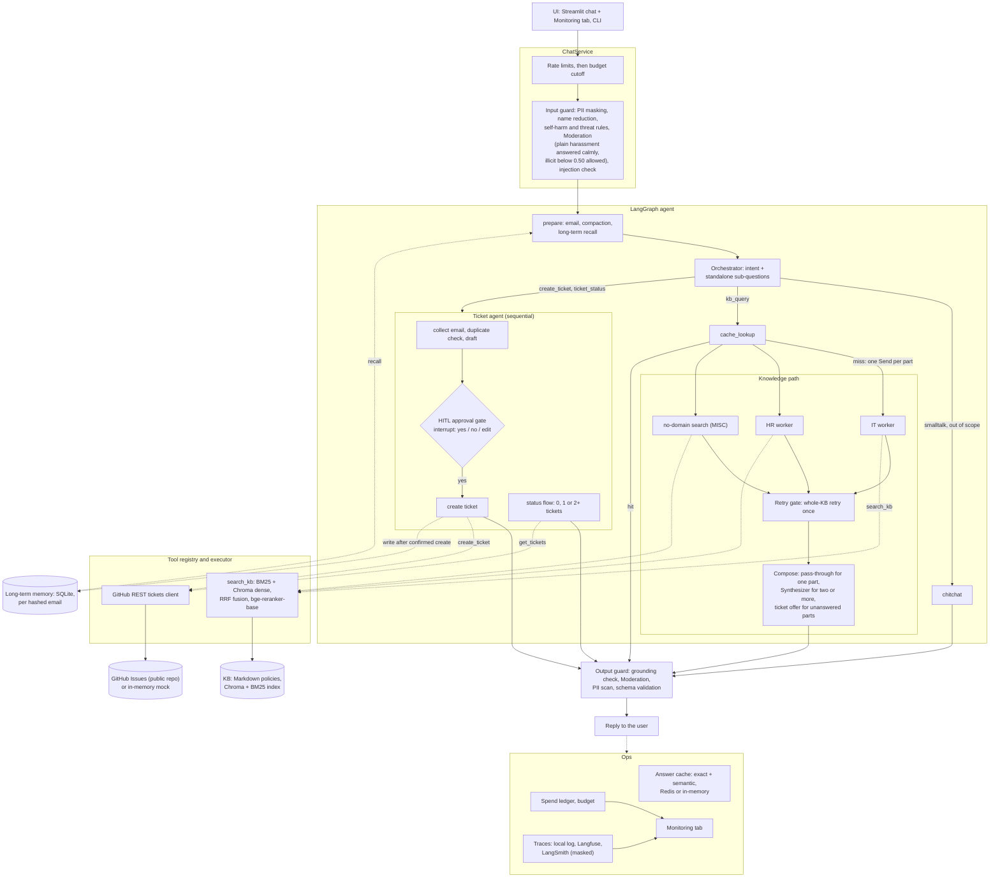

# SmartDesk AI architecture

One request goes through the chat service (guards, limits), the LangGraph agent, the tools, the output guard and the ops layer.
State lives in a SQLite checkpointer keyed by `thread_id` only. The same diagram is exported as [`architecture.svg`](architecture.svg) and [`architecture.png`](architecture.png); this file is the single source (FR-I1 to I9, PLAN section 4).

